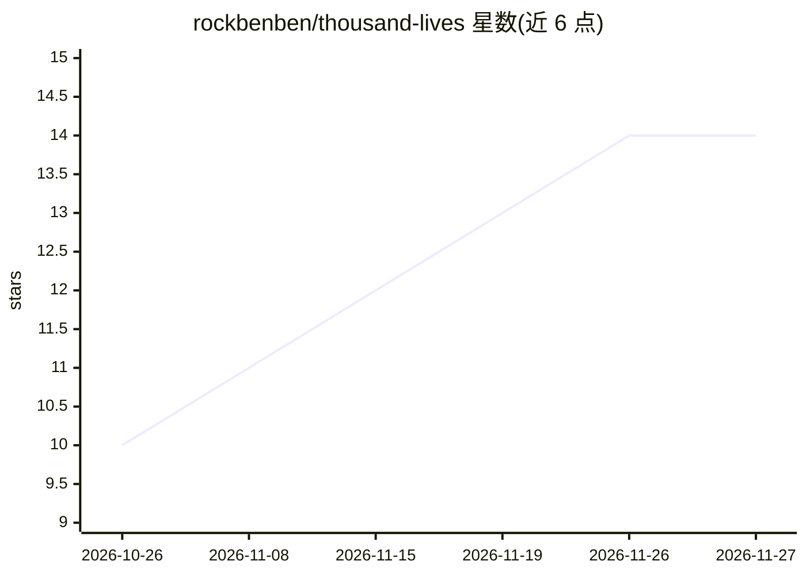

# rockbenben/thousand-lives

⭐ 14 · TypeScript · MIT · 推送 2026-11-26 · [GitHub](https://github.com/rockbenben/thousand-lives) · [官网](https://lives.newzone.top) · 个人维护 · 中文 README

**10 个中文剧本的 AI 文字人生模拟器，浏览器即玩**

纯前端文字人生游戏：10 个中文剧本（仙侠/谍战/末世/三国等），每回合读剧情做抉择，属性数值影响后续剧情走向，约四十回合后触发结局。本地模式用手写事件池无需 API Key 即可整局游玩；填 Key 后由大模型驱动剧情，并可用一句主题让 AI 现场生成新剧本或导入 JSON 剧本。存档仅存浏览器 localStorage，清缓存或换设备会丢失。

## 筛选速览

| 维度 | 判定 | 备注 |
|---|---|---|
| AI 角色 | `ai-native` | 本体是模型或模型工具 |
| 许可风险 | `permissive` | MIT |
| 部署形态 | `None` |  |
| 模型依赖 | — | README 未给出锁定关系 |
| 硬件要求 | — | 无带数字的原话,不猜 |
| 安装摩擦 | `low` | 无编译、无系统依赖或容器化 |
| 成熟度 | — | 结构信号不足 |

## 能力要点

- 10 个中文剧本，各含独立属性、事件池与结局系统
- 本地事件池模式无需 API Key 即可完整游玩
- 填 Key 后支持 24 家预设服务商，可用 AI 现场生成新剧本
- 61 枚成就与结局图鉴，结局卡可分享到社交平台

## 适用场景

- 浏览器里体验 AI 驱动的文字人生模拟
- 不用 API Key 也能完整玩完一局剧情
- 自己写一个行动交给 AI 裁定的自由玩法
- 导入或生成自定义 JSON 剧本游玩

## 场景标签

 · 领域:游戏/互动叙事

## 证据(README 行号)

> L3: > AI 文字人生模拟器：一回合一次抉择，走到属于你的结局，免 Key 即玩
> L44: - **数字即故事**：属性按数值落入命名状态（理智「清醒 / 动摇 / 濒临崩溃」），作为硬指令注入 AI——理智崩了就必然出现幻觉
> L57: 想换成自己的大模型：右上角 ☰ → 设置 → 选服务商（内置 24 家预设，自动填好 Base URL 与推荐模型）→ 填 Key。

## 星数曲线

2026-10-26 10 → 2026-11-27 14（+4）

---
*卡片 v1 · prompt 1.4 · 生成 2026-11-18 · 置信度 high · 依据 README sha `c4308d7570c7` · [字段定义](../../DATASET.md)*
