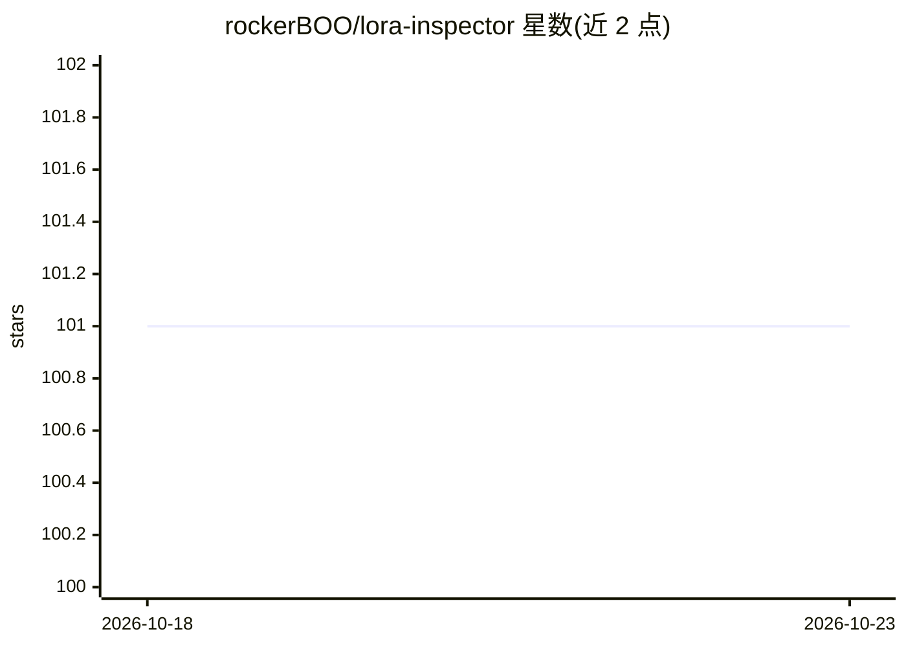

# rockerBOO/lora-inspector

⭐ 101 · Python · MIT · 推送 2026-10-06 · [GitHub](https://github.com/rockerBOO/lora-inspector) · 个人维护

**Stable Diffusion LoRA 文件元数据与权重检查工具**

单文件 Python 脚本，读取 safetensors 格式的 LoRA 文件，提取训练参数（epoch、rank、optimizer 等）、计算权重平均幅度与强度、统计标签频率、查看数据集目录，并可把元数据保存为 JSON；附带 update_metadata.py 修改元数据字段。限制：仅支持 safetensors、仅解析 kohya-ss 格式元数据，自述为进行中项目不建议生产使用。安装方式为克隆仓库并自行安装 torch/safetensors/tqdm 依赖。

## 筛选速览

| 维度 | 判定 | 备注 |
|---|---|---|
| AI 角色 | `ai-ecosystem` | LLM/agent 周边工具 |
| 许可风险 | `permissive` | MIT |
| 部署形态 | `library` | 以包/库形式分发 |
| 模型依赖 | — | README 未给出锁定关系 |
| 硬件要求 | — | 无带数字的原话,不猜 |
| 安装摩擦 | `low` | 无编译、无系统依赖或容器化 |
| 成熟度 | `idea` | |

## 能力要点

- 提取并保存 LoRA 训练参数元数据到 JSON
- 计算 UNet 与 Text Encoder 权重平均幅度/强度
- 标签频率统计与数据集目录概览
- 附 update_metadata.py 脚本修改元数据字段

## 适用场景

- 训练完 LoRA 后核对训练参数与超参配置
- 对比多个 LoRA 的权重强度指标
- 查找或修改元数据中的 ss_output_name 等字段

## 场景标签

 · 领域:图像生成/模型工具

## 证据(README 行号)

> L7: Inspect LoRA files for meta info and quantitative analysis of the
> L8: LoRA weights.

## 星数曲线

2026-10-18 101 → 2026-10-23 101（+0）

---
*卡片 v1 · prompt 1.4 · 生成 2026-10-23 · 置信度 mid · 依据 README sha `7e0bcfe8b26d` · [字段定义](../../DATASET.md)*
