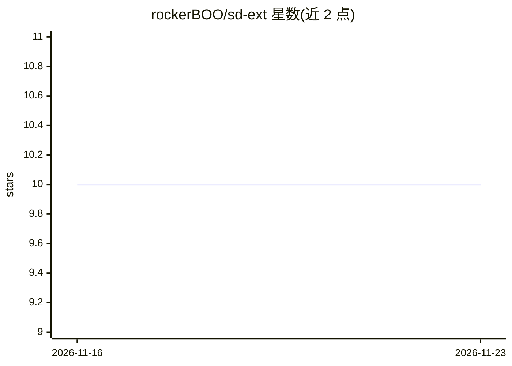

# rockerBOO/sd-ext

⭐ 10 · Python · MIT · 推送 2026-08-24 · [GitHub](https://github.com/rockerBOO/sd-ext) · 个人维护

**Stable Diffusion 的脚本与扩展集合：分析、剪枝、提取与推理**

一组配合 Stable Diffusion 使用的 Python 脚本，按功能分为分析（CLIP 分数、嵌入、图像相似度、FID）、剪枝、LoRA 块提取、safetensors 格式转换、多模型推理与元数据读取。推荐克隆到其他仓库中复用其依赖，支持 poetry 或 pip 安装，脚本基于 accelerate 启动，各脚本提供 --help 查看用法。

## 筛选速览

| 维度 | 判定 | 备注 |
|---|---|---|
| AI 角色 | `ai-native` | 本体是模型或模型工具 |
| 许可风险 | `permissive` | MIT |
| 部署形态 | `library` | 以包/库形式分发 |
| 模型依赖 | — | README 未给出锁定关系 |
| 硬件要求 | — | 无带数字的原话,不猜 |
| 安装摩擦 | `low` | 无编译、无系统依赖或容器化 |
| 成熟度 | — | 结构信号不足 |

## 能力要点

- 分析脚本覆盖 CLIP 分数/嵌入、图像相似度、FID 等指标
- 支持模型剪枝、LoRA 块提取与 safetensors 批量转换
- 推理脚本覆盖多个 SD 模型（SDXL-Turbo、Moondream 等）
- 通过 accelerate 启动脚本运行

## 适用场景

- 评估生成图像与文本的 CLIP 相似度
- 对 SD 模型做权重剪枝与键清理
- 从模型中提取 LoRA 块权重
- 批量转换模型文件为 safetensors 格式

## 场景标签

`图像生成` `模型评测` · 领域:评测与运维

## 证据(README 行号)

> L33: ## Inference
> L35: - sdv.py

## 星数曲线

2026-11-16 10 → 2026-11-23 10（+0）

---
*卡片 v1 · prompt 1.4 · 生成 2026-11-19 · 置信度 mid · 依据 README sha `76adb42db45f` · [字段定义](../../DATASET.md)*
