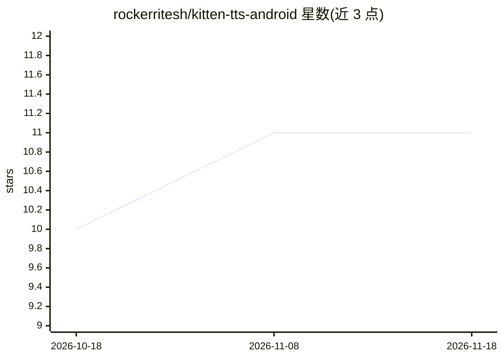

# rockerritesh/kitten-tts-android

⭐ 11 · Kotlin · 推送 2026-05-29 · [GitHub](https://github.com/rockerritesh/kitten-tts-android) · 个人维护

**面向雅思学习者的离线端侧朗读/口语训练 Android 应用**

基于 KittenML 神经 TTS 与端侧 Whisper 转录的 Android 应用，用于雅思口语与朗读练习：朗读模式录制 16kHz 音频，由 ONNX 版 whisper-tiny.en 端侧转录，逐词对齐计算 WER、朗读准确率与四项雅思分项估算；口语模式提供 Part 1–3 提示并做流利度分析（语速、停顿、填充词）；另有 Voice Studio 提供 3 种尺寸模型、8 种音色的文本转语音，支持长文本分块合成与 WAV 导出。模型随 APK 打包，安装后完全离线。发布渠道为 Releases APK，源码构建需 Android Studio、NDK 27+ 与 JDK 17。README 说明雅思分项估算为基于朗读准确率、覆盖率与语速的近似。

## 筛选速览

| 维度 | 判定 | 备注 |
|---|---|---|
| AI 角色 | `ai-native` | 本体是模型或模型工具 |
| 许可风险 | `none` | — |
| 部署形态 | `None` |  |
| 模型依赖 | — | README 未给出锁定关系 |
| 硬件要求 | — | 无带数字的原话,不猜 |
| 安装摩擦 | `medium` | 含编译或系统依赖之一 |
| 成熟度 | — | 结构信号不足 |

## 能力要点

- 端侧 Whisper 转录 + WER 逐词对齐评分，完全离线运行
- 朗读与自由口语的雅思四项分项及总分估算
- Voice Studio 提供 Nano(15M)/Micro(40M)/Mini(80M) 三种 TTS 模型、8 种音色、0.5x–2.0x 语速
- 长文本按句自动分块合成并拼接为单一音频，可导出 WAV

## 适用场景

- 离线练习雅思朗读并查看逐词正误标注
- 录制口语回答，获得流利度与四项分项反馈
- 用神经语音试听任意文章并下载 WAV 音频

## 场景标签

`语音合成` · 领域:内容生成

## 证据(README 行号)

> L3: An on-device English learning app for **IELTS speaking and reading practice**, built on
> L61: - 100% on-device inference via ONNX Runtime
> L100: |ML Inference|ONNX Runtime Android (TTS + Whisper ASR)|

## 星数曲线

2026-10-18 10 → 2026-11-18 11（+1）

---
*卡片 v1 · prompt 1.4 · 生成 2026-11-18 · 置信度 high · 依据 README sha `c282d3036769` · [字段定义](../../DATASET.md)*
