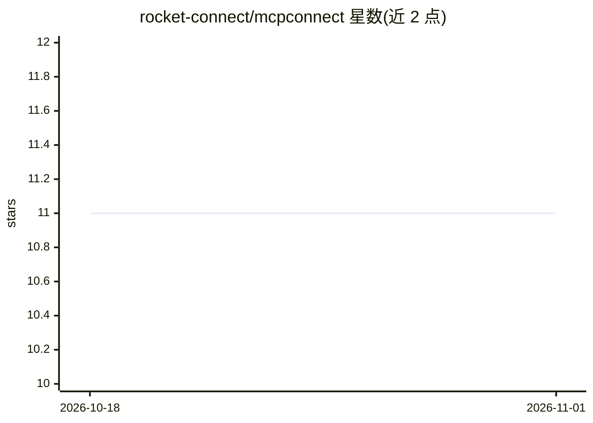

# rocket-connect/mcpconnect

⭐ 11 · TypeScript · MIT · 推送 2025-12-06 · [GitHub](https://github.com/rocket-connect/mcpconnect) · [官网](https://mcp.rconnect.tech) · 组织维护

**浏览器端 MCP 服务器调试与测试的开发环境**

面向开发者的基于浏览器的 Model Context Protocol (MCP) 开发环境：支持通过 HTTP、WebSocket、SSE 连接任意 MCP 服务器，可调用 Claude 或 OpenAI 模型测试工具，提供协议检查调试、工具启用控制（以节省 token）、对话导出为 JSON/Markdown。附 Supabase、GitHub、Neo4j MCP 服务器的接入指南。通过 npx 一行命令启动并打开浏览器，MIT 许可。

## 筛选速览

| 维度 | 判定 | 备注 |
|---|---|---|
| AI 角色 | `ai-ecosystem` | LLM/agent 周边工具 |
| 许可风险 | `permissive` | MIT |
| 部署形态 | `library` | 以包/库形式分发 |
| 模型依赖 | — | README 未给出锁定关系 |
| 硬件要求 | — | 无带数字的原话,不猜 |
| 安装摩擦 | `low` | 无编译、无系统依赖或容器化 |
| 成熟度 | — | 结构信号不足 |

## 能力要点

- 通过 HTTP/WebSocket/SSE 连接任意 MCP 服务器
- 用 Claude 或 OpenAI 模型测试工具
- 协议检查调试与工具启用控制
- 对话导出为 JSON/Markdown

## 适用场景

- 调试和检查自建 MCP 服务器的协议交互
- 在浏览器中手动执行与测试 MCP 工具
- 控制启用的工具以节省 token

## 场景标签

`Agent 框架` · 领域:Agent 开发

## 证据(README 行号)

> L7: Browser-based development environment for debugging and testing Model Context Protocol (MCP) servers.
> L27: - **Test** tools with Claude or OpenAI models

## 星数曲线

2026-10-18 11 → 2026-11-01 11（+0）

---
*卡片 v1 · prompt 1.4 · 生成 2026-11-01 · 置信度 high · 依据 README sha `45fc6b15e1ee` · [字段定义](../../DATASET.md)*
