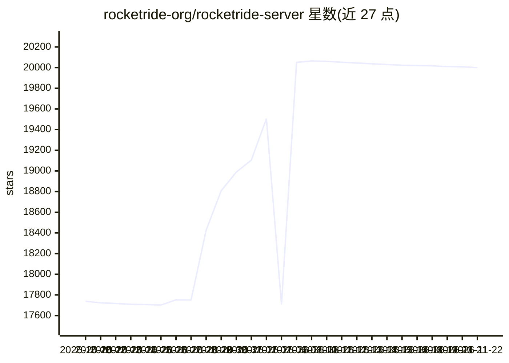

# rocketride-org/rocketride-server

⭐ 20,000 · Python · MIT · 推送 2026-11-21 · [GitHub](https://github.com/rocketride-org/rocketride-server) · [官网](https://rocketride.ai) · 组织维护

**开源 AI 元框架：构建、测试并部署生产级 agent 管线**

RocketRide 是一个开源 AI meta-harness，覆盖 AI 开发生命周期的构建、暂存、测试、发布与维护。核心机制包括：IDE 内可视化画布（Rocket Builder）用节点编排管线，管线保存为可版本控制的 JSON `.pipe` 文件；底层为 C++ 高吞吐运行时；节点库涵盖 LLM 提供商、向量数据库、OCR、NER、PII 匿名化、嵌入模型等，节点可用 Python 扩展。提供 Python/TypeScript SDK、内置 MCP 服务器与 VS Code 扩展。可本地运行、Docker/on-prem 自托管或使用 RocketRide Cloud 托管。MIT 许可，无企业版。

## 筛选速览

| 维度 | 判定 | 备注 |
|---|---|---|
| AI 角色 | `ai-ecosystem` | LLM/agent 周边工具 |
| 许可风险 | `permissive` | MIT |
| 部署形态 | `self-host` | docker 或自建部署 |
| 模型依赖 | — | README 未给出锁定关系 |
| 硬件要求 | — | 无带数字的原话,不猜 |
| 安装摩擦 | `low` | 无编译、无系统依赖或容器化 |
| 成熟度 | — | 结构信号不足 |

## 动量与使用信号

- 维护:`active` — 距上次 push 0.7 天,年发版 59,75 位贡献者
- 涨星:近 1 天 **-6**(自 20261016 起算)
- 安装:npm 包 `rocketride` 月下载 512
- 平台:— · 协议:MCP

## 能力要点

- IDE 可视化画布编排管线，`.pipe` 为可 diff 的 JSON，可跨环境运行
- C++ 原生多线程运行时，节点库含 LLM、向量库、OCR、NER、PII 匿名化等
- Python/TypeScript SDK 与内置 MCP 服务器，自动检测 Claude、Cursor 等编码 agent
- 可观测性：追踪调用树、token 用量、延迟与内存消耗

## 适用场景

- 在 IDE 里拖拽节点搭建并调试文档处理、RAG、agent 工作流管线
- 把 AI 管线以一行 SDK 调用嵌入 Python 或 TypeScript 应用
- 自托管引擎做本地数据处理，数据不出机器
- 通过编码 agent 用自然语言构建和部署管线

## 场景标签

`Agent 框架` `工作流自动化` `LLM 可观测性` `RAG` · 领域:Agent 开发

## 证据(README 行号)

> L15:  RocketRide gives you one place to compose, debug, observe, and deploy AI runtimes from the tools you already use: 
> L17:  Under the hood, RocketRide is an open source meta-harness spanning the full AI Development Lifecycle (AIDLC): buil
> L57: |**Pipeline Nodes**|LLM providers, vector databases, OCR, NER, PII anonymization, chunking strategies, embedding mo

## 星数曲线

2026-10-20 17,738 → 2026-11-22 20,000（+2,262）

---
*卡片 v1 · prompt 1.4 · 生成 2026-11-22 · 置信度 high · 依据 README sha `c75b4296fa50` · [字段定义](../../DATASET.md)*
