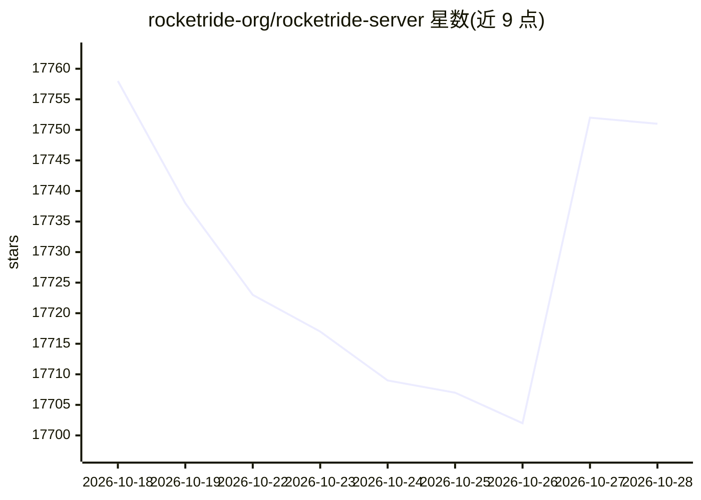

# rocketride-org/rocketride-server

⭐ 18,426 · Python · MIT · 推送 2026-10-28 · [GitHub](https://github.com/rocketride-org/rocketride-server) · 组织维护

**在 IDE 中构建、调试和部署 AI/LLM 管线的开源引擎**

RocketRide 是一个开源 AI 管线构建器与运行时：管线以 .pipe JSON 定义，可在 VS Code 可视化画布中编辑，由多线程 C++ 引擎执行，也可在 Docker、本地或 RocketRide Cloud 部署。README 称含 100+ 节点，覆盖 15+ LLM 提供商、9 个向量数据库、OCR、NER、PII 匿名化等，节点可用 Python 扩展；提供 Python/TypeScript/MCP SDK、VS Code 扩展，内置 CrewAI 与 LangChain 支持，带 token 用量与延迟等可观测性功能。示例管线可在本地模型上运行，无需 API key。

## 筛选速览

| 维度 | 判定 | 备注 |
|---|---|---|
| AI 角色 | `ai-native` | 本体是模型或模型工具 |
| 许可风险 | `permissive` | MIT |
| 部署形态 | `self-host` | docker 或自建部署 |
| 模型依赖 | — | README 未给出锁定关系 |
| 硬件要求 | — | 无带数字的原话,不猜 |
| 安装摩擦 | `low` | 无编译、无系统依赖或容器化 |
| 成熟度 | — | 结构信号不足 |

## 动量与使用信号

- 维护:`active` — 距上次 push 0.7 天,年发版 59,75 位贡献者
- 涨星:近 1 天 **-6**(自 20261016 起算)
- 安装:npm 包 `rocketride` 月下载 512
- 平台:— · 协议:MCP

## 能力要点

- 管线以可移植 JSON（.pipe）定义，VS Code 可视化画布构建与调试
- C++ 多线程运行时执行，节点可 Python 扩展
- 提供 Python、TypeScript 与 MCP SDK，集成到应用中调用
- 内建可观测性：调用树、token 用量、内存与延迟追踪

## 适用场景

- 在 IDE 里搭建 RAG 文档问答管线
- 构建含 OCR/NER/PII 处理的文档处理流程
- 将 AI 管线作为函数从 Python 或 TypeScript 应用调用
- 在自有基础设施上运行多 agent 工作流

## 场景标签

`工作流自动化` `RAG` `多智能体` · 领域:Agent 开发

## 证据(README 行号)

> L5:  RocketRide is the open source AIDE: the AI Development Environment.
> L14:  Under the hood, RocketRide is an open source data pipeline builder and runtime built for AI and ML workloads. With
> L56: |**TypeScript, Python & MCP SDKs**|Integrate pipelines into native apps, expose them as callable tools for AI assis

## 星数曲线

2026-10-18 17,758 → 2026-10-28 17,751（-7）

---
*卡片 v1 · prompt 1.4 · 生成 2026-10-18 · 置信度 high · 依据 README sha `60e95bf9c355` · [字段定义](../../DATASET.md)*
