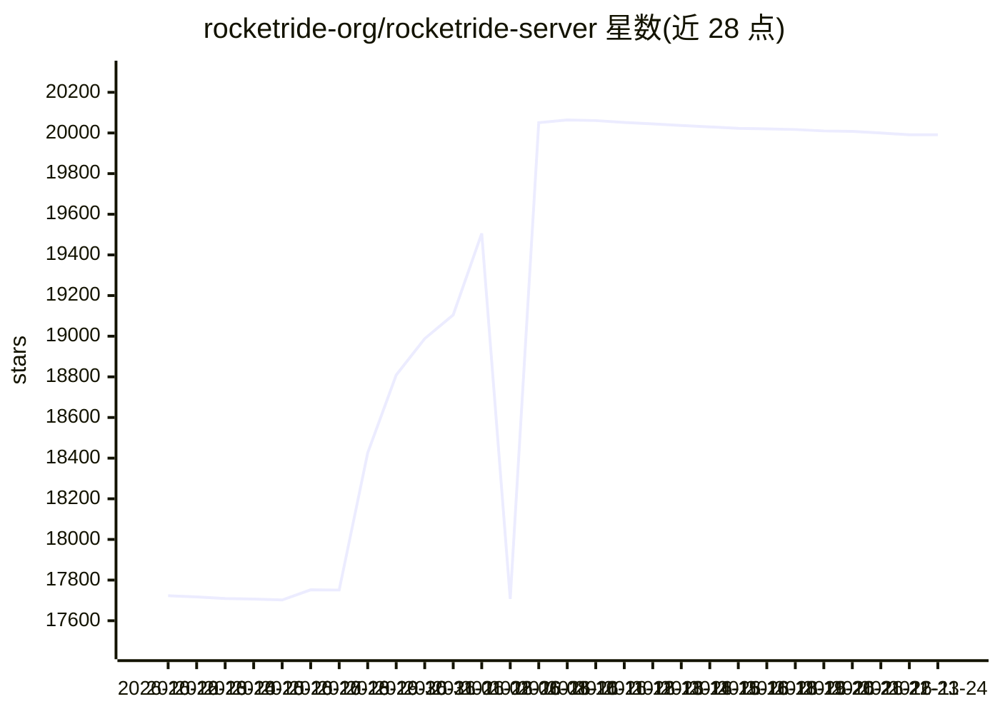

# rocketride-org/rocketride-server

⭐ 19,992 · Python · MIT · 推送 2026-11-24 · [GitHub](https://github.com/rocketride-org/rocketride-server) · [官网](https://rocketride.ai) · 组织维护

**帮助开发者构建、调试、部署生产级 AI agent 的 C++ 运行时与编排平台**

RocketRide 定位为开源 AI meta-harness，覆盖构建、暂存、测试、发布、维护的完整生命周期。核心机制包括：IDE 内可视化画布（Rocket Builder）拖拽编排节点、以可移植 JSON（.pipe 文件）保存 pipeline、节点库含 LLM provider、向量库、OCR、NER、PII 匿名化等并可用 Python 扩展、内置 CrewAI 与 LangChain 多 agent 支持、深度可观测性（token 用量、调用树、延迟）。运行时为 C++ 实现，镜像仅 amd64，可通过 Docker、本地进程或 RocketRide Cloud 运行。MIT 许可，无企业版。

## 筛选速览

| 维度 | 判定 | 备注 |
|---|---|---|
| AI 角色 | `ai-ecosystem` | LLM/agent 周边工具 |
| 许可风险 | `permissive` | MIT |
| 部署形态 | `self-host` | docker 或自建部署 |
| 模型依赖 | — | README 未给出锁定关系 |
| 硬件要求 | — | 无带数字的原话,不猜 |
| 安装摩擦 | `low` | 无编译、无系统依赖或容器化 |
| 成熟度 | — | 结构信号不足 |

## 动量与使用信号

- 维护:`active` — 距上次 push 0.7 天,年发版 59,75 位贡献者
- 涨星:近 1 天 **-6**(自 20261016 起算)
- 安装:npm 包 `rocketride` 月下载 512
- 平台:— · 协议:MCP

## 能力要点

- IDE 内可视化 canvas 编排 pipeline，保存为可版本控制的 JSON .pipe 文件
- 节点库覆盖 LLM、向量库、OCR、NER、PII 匿名化、embedding，支持 Python 扩展
- 内置 CrewAI 与 LangChain 多 agent 工作流支持
- 深度可观测性：调用树、token 用量、内存与延迟追踪

## 适用场景

- 在 IDE 中以可视化方式搭建并调试 AI 工作流
- 将文档处理（OCR/NER/PII 清洗）pipeline 集成进 Python/TypeScript 应用
- 自托管运行生产级 agent 并追踪 token 与延迟
- 通过内置 MCP server 让编码 agent 操作 pipeline

## 场景标签

`Agent 框架` `多智能体` `工作流自动化` `LLM 可观测性` · 领域:Agent 开发

## 证据(README 行号)

> L14:  RocketRide gives you one place to compose, debug, observe, and deploy AI runtimes from the tools you already use: 
> L16:  Under the hood, RocketRide is an open source meta-harness spanning the full AI Development Lifecycle (AIDLC): buil

## 星数曲线

2026-10-22 17,723 → 2026-11-24 19,991（+2,268）

---
*卡片 v1 · prompt 1.4 · 生成 2026-11-24 · 置信度 high · 依据 README sha `26a2f820055a` · [字段定义](../../DATASET.md)*
