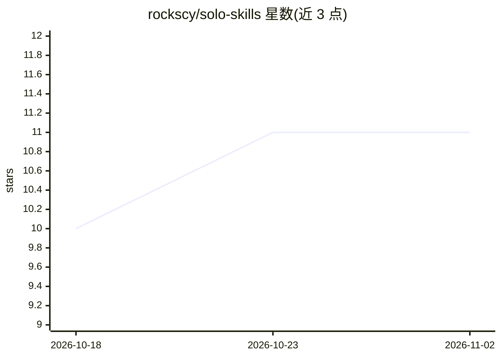

# rockscy/solo-skills

⭐ 11 · Shell · MIT · 推送 2026-07-01 · [GitHub](https://github.com/rockscy/solo-skills) · 个人维护 · 中文 README

**面向独立开发者的 7 个双语 Claude Code 技能包**

为 solo founder 与独立开发者提供的 Claude Code 技能集合，含 7 个技能（英文+中文双语）：产品决策、发布推文撰写、git log 转发布说明、用户消息转可复现 bug 报告、个人站会、客户邮件回复、无责复盘。每个技能以 SKILL.md 形式定义，包含“何时不该用”边界与完整输入→输出示例。通过一行 curl|bash 安装到 ~/.claude/skills/，在 Claude Code 会话中自动或显式触发。

## 筛选速览

| 维度 | 判定 | 备注 |
|---|---|---|
| AI 角色 | `ai-ecosystem` | LLM/agent 周边工具 |
| 许可风险 | `permissive` | MIT |
| 部署形态 | `None` |  |
| 模型依赖 | — | README 未给出锁定关系 |
| 硬件要求 | — | 无带数字的原话,不猜 |
| 安装摩擦 | `low` | 无编译、无系统依赖或容器化 |
| 成熟度 | — | 结构信号不足 |

## 能力要点

- 7 个技能覆盖决策/写作/复盘等独立开发日常任务
- 每个技能含 “Do NOT use when…” 边界与 worked example
- 英文+简体中文双语
- 一行 curl|bash 安装，不覆盖同名已有文件

## 适用场景

- 独立开发者用 Claude Code 处理客户邮件与发布推文
- 一个人做站会与错过截止日期后的复盘
- 把模糊的用户反馈转成可复现的 bug 报告

## 场景标签

`提示工程` · 领域:Agent 开发

## 证据(README 行号)

> L3: > Claude Code skills for people who ship alone.
> L16: A small, opinionated set of Claude Code skills for the tasks solo founders and indie devs actually do every day: wr

## 星数曲线

2026-10-18 10 → 2026-11-02 11（+1）

---
*卡片 v1 · prompt 1.4 · 生成 2026-11-01 · 置信度 high · 依据 README sha `2e7a96168814` · [字段定义](../../DATASET.md)*
