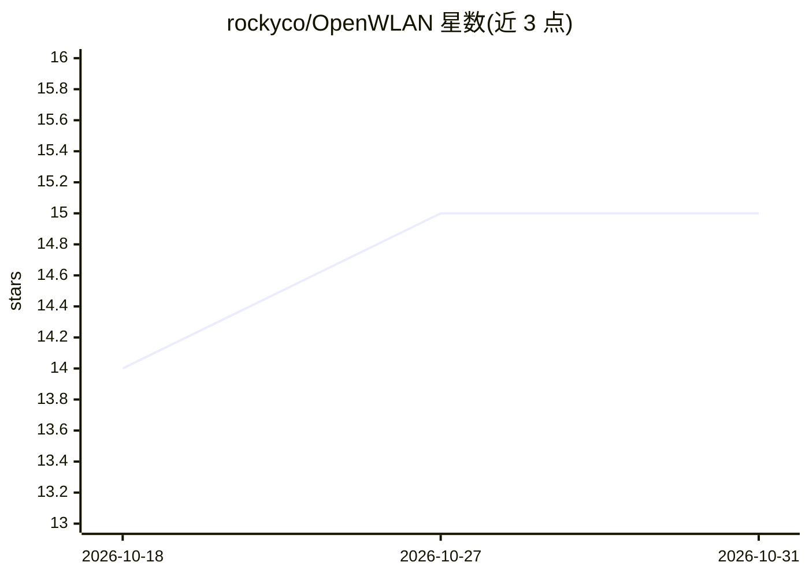

# rockyco/OpenWLAN

⭐ 15 · Verilog · 推送 2026-02-05 · [GitHub](https://github.com/rockyco/OpenWLAN) · 个人维护

**AI 驱动的 MATLAB→HLS 框架：WLAN 同步算法 FPGA 实现**

面向 FPGA 开发者与无线通信研究者的 MATLAB-to-HLS 自动转换框架：将 WLAN 802.11 时频同步算法经 7 阶段流水线（模块划分、展平、优化、审查、HLS 生成、定点化、集成）转换为可综合 HLS C++，代码由 AI 生成。仓库含 AI 生成的 HLS 版与 MathWorks HDL Coder 参考实现，在 Zynq-7020 上功能等价，HLS 版 LUT/FF 占用更少。注意：MATLAB 源与测试向量公开，但 HLS C++ 源码为私有 IP 未包含在仓库中。

## 筛选速览

| 维度 | 判定 | 备注 |
|---|---|---|
| AI 角色 | `ai-native` | 本体是模型或模型工具 |
| 许可风险 | `none` | — |
| 部署形态 | `None` |  |
| 模型依赖 | — | README 未给出锁定关系 |
| 硬件要求 | — | 无带数字的原话,不猜 |
| 安装摩擦 | `low` | 无编译、无系统依赖或容器化 |
| 成熟度 | — | 结构信号不足 |

## 能力要点

- 7 阶段 AI 转换流水线：MATLAB 工具箱调用→展平→流式优化→HLS C++ 生成
- 五个流式 HLS 模块均达 II=1，100 MHz 时序收敛
- 与 HDL Coder 参考实现在 Zynq-7020 上给出资源/时序/CFO 精度对比数据
- 提供 MATLAB 测试脚本与 Vitis HLS Makefile 构建目标（csim/csynth/cosim/impl）

## 适用场景

- 研究 MATLAB 算法到 HLS C++ 的自动化转换方法
- 对比 AI 生成 HLS 与 HDL Coder 在 FPGA 资源与精度上的结果
- 复现 WLAN 802.11 同步算法的定点/浮点验证流程

## 场景标签

`代码生成` `科研工具` · 领域:编码与开发

## 证据(README 行号)

> L12: - **A2H_Coder** - AI-generated HLS C++ via a 7-phase transformation pipeline (all code AI-generated)
> L114: The 7-phase framework pipeline:

## 星数曲线

2026-10-18 14 → 2026-10-31 15（+1）

---
*卡片 v1 · prompt 1.4 · 生成 2026-10-30 · 置信度 high · 依据 README sha `2701fd7ef46b` · [字段定义](../../DATASET.md)*
