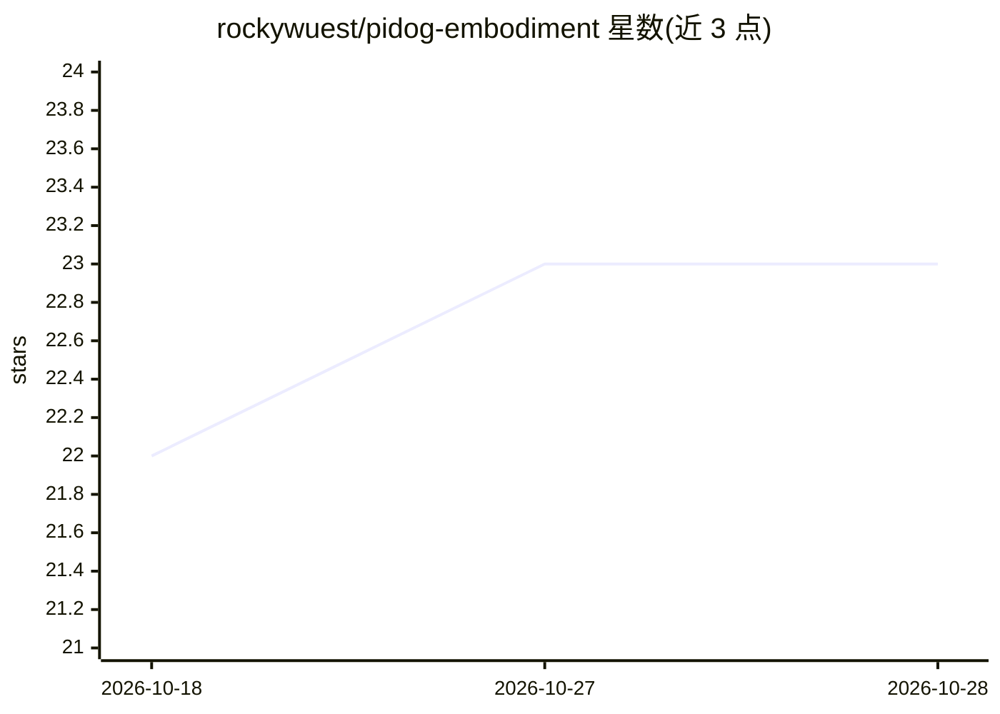

# rockywuest/pidog-embodiment

⭐ 23 · Python · MIT · 推送 2026-10-26 · [GitHub](https://github.com/rockywuest/pidog-embodiment) · 个人维护

**给树莓派机器狗接上本地 LLM 大脑的开源具身框架**

将运行在树莓派 5 或任意电脑上的"大脑"与运行在树莓派 4 机器人上的"机身"通过 HTTP 分离连接的框架，适配 SunFounder PiDog 及其他硬件（实现一个适配器即可）。功能包括：自然语言语音控制（Vosk 唤醒词 + STT、Piper TTS）、6 状态行为引擎与情绪系统、SCRFD+ArcFace 人脸识别、SmolVLM-256M 本地视觉（llama.cpp）、表情与舵机控制，以及把整机暴露为 10 个工具的 MCP 服务器供 Claude Code/Desktop 调用。LLM 可接 OpenAI、Anthropic、Ollama 或任意 OpenAI 兼容端点，亦有无 LLM 的关键词命令模式；支持 ./install.sh --mock 无硬件试用。机身服务仅能在机器人的树莓派上运行。

## 筛选速览

| 维度 | 判定 | 备注 |
|---|---|---|
| AI 角色 | `ai-native` | 本体是模型或模型工具 |
| 许可风险 | `permissive` | MIT |
| 部署形态 | `library` | 以包/库形式分发 |
| 模型依赖 | local-ok | 支持本地模型 |
| 硬件要求 | — | 无带数字的原话,不猜 |
| 安装摩擦 | `medium` | 含编译或系统依赖之一 |
| 成熟度 | — | 结构信号不足 |

## 能力要点

- Brain/Body 架构：LLM 大脑与机器人机身经 HTTP 分离部署
- 整机作为 MCP 服务器提供 10 个工具，供 Claude Code/Desktop 等客户端调用
- 本地视觉（SmolVLM-256M via llama.cpp）与人脸识别（SCRFD+ArcFace）
- 无硬件可用 --mock 模式在 localhost 运行模拟机器狗

## 适用场景

- 给 SunFounder PiDog 或自制机器人加自然语言语音控制和自主行为
- 通过 Claude Code/Desktop 作为机器人大脑远程操控拍照、移动等动作
- 在无云端依赖的前提下用 Ollama 本地模型驱动机器人对话

## 场景标签

`语音合成` `语音识别` `人脸识别` · 领域:内容生成

## 证据(README 行号)

> L15: A complete open-source framework for connecting an **AI brain** (Raspberry Pi 5 / any computer) to a **robot body**
> L42: - **🗣️ Natural Voice Control** — Speak naturally in any language, LLM understands intent and maps to actions
> L43: - **🔌 MCP Server (NEW)** — the whole robot as tools for Claude Code, Claude Desktop or any MCP client: *"take a pho

## 星数曲线

2026-10-18 22 → 2026-10-28 23（+1）

---
*卡片 v1 · prompt 1.4 · 生成 2026-10-27 · 置信度 mid · 依据 README sha `2ef377dfc0e3` · [字段定义](../../DATASET.md)*
