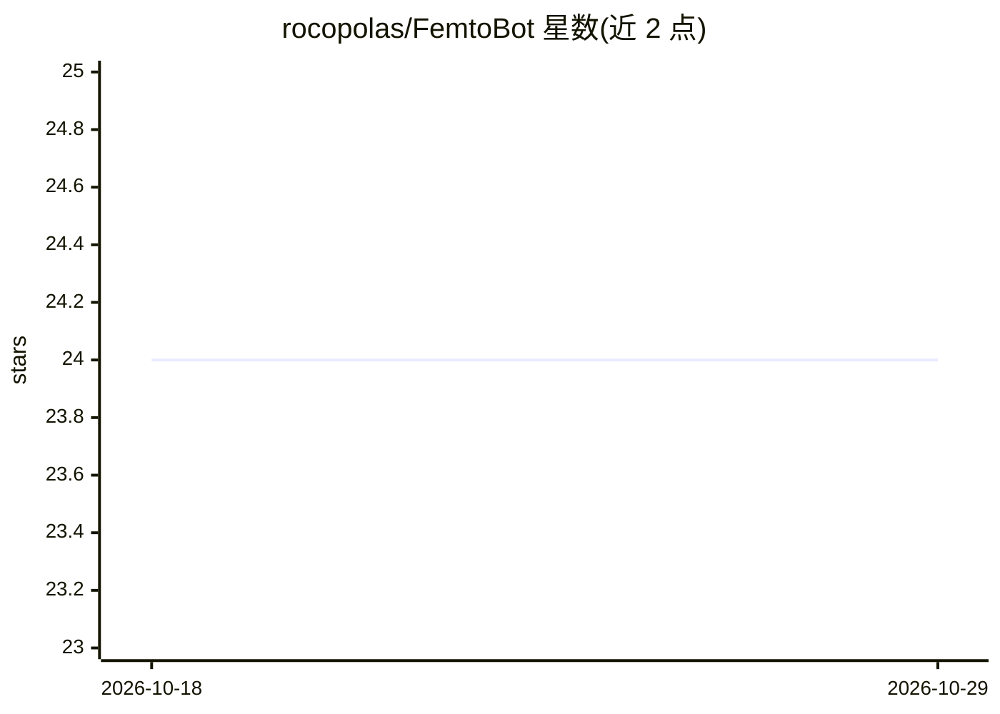

# rocopolas/FemtoBot

⭐ 24 · Python · 推送 2026-03-04 · [GitHub](https://github.com/rocopolas/FemtoBot) · 个人维护

**面向小型本地模型的个人 AI 助手，提供 Telegram 机器人与 TUI**

本地运行的个人助手，通过 Ollama 或 LM Studio 加载小型 LLM（建议 8GB 以上显存的 GPU），以 Telegram 机器人和终端 TUI 两种界面交互。功能包括本地 LLM 对话、基于嵌入的向量记忆（RAG）、PDF/TXT 文档检索与阅读、视觉模型图像分析、Whisper 语音转写、YouTube 摘要、Gmail 邮件摘要、迭代式 Deep Research、定时任务与 WIZ 智能灯控制等。支持 SKILL.md 技能文件动态注入系统提示词。提供 curl 一键安装脚本与 femtobot CLI（setup/doctor/wizard/start 等命令），MIT 许可。

## 筛选速览

| 维度 | 判定 | 备注 |
|---|---|---|
| AI 角色 | `ai-native` | 本体是模型或模型工具 |
| 许可风险 | `none` | — |
| 部署形态 | `library` | 以包/库形式分发 |
| 模型依赖 | local-ok | 支持本地模型 |
| 硬件要求 | — | 无带数字的原话,不猜 |
| 安装摩擦 | `medium` | 含编译或系统依赖之一 |
| 成熟度 | — | 结构信号不足 |

## 能力要点

- 基于 Ollama/LM Studio 的本地 LLM 对话，无外部 API 依赖
- 向量记忆（RAG）与 PDF/TXT 文档索引检索
- Whisper 语音转写与视觉模型图像分析
- SKILL.md 技能文件动态注入系统提示词

## 适用场景

- 在 Telegram 上使用完全本地的 AI 个人助手对话
- 让助手阅读 PDF、总结 YouTube 视频与邮件并做深度研究
- 通过对话控制 WIZ 智能灯、设置定时提醒

## 场景标签

`AI 助手` `文档问答` · 领域:对话与助手

## 证据(README 行号)

> L3: A smart personal assistant designed for small local models, recommended for GPUs with at least 8GB of VRAM. Runs loc
> L7: - 💬 **Local LLM chat** - No external API dependencies
> L142: ### Telegram Bot

## 星数曲线

2026-10-18 24 → 2026-10-29 24（+0）

---
*卡片 v1 · prompt 1.4 · 生成 2026-10-27 · 置信度 mid · 依据 README sha `d87edb877a8f` · [字段定义](../../DATASET.md)*
