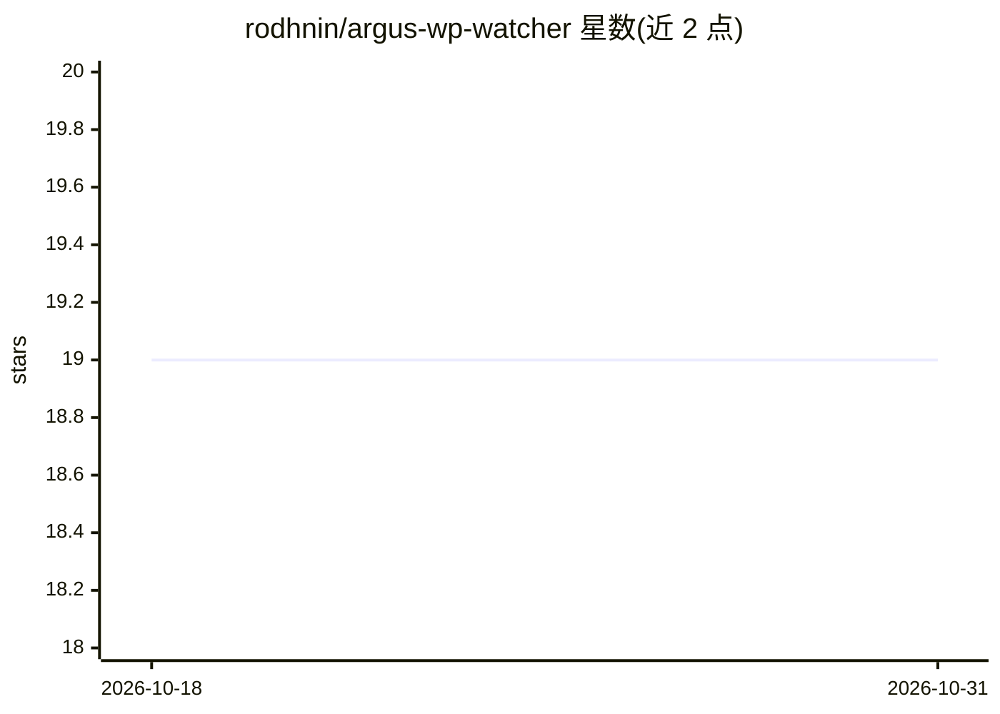

# rodhnin/argus-wp-watcher

⭐ 19 · Python · NOASSERTION · 推送 2026-05-01 · [GitHub](https://github.com/rodhnin/argus-wp-watcher) · 个人维护

**面向渗透测试人员的 WordPress 漏洞扫描器，附 AI 分析与合规授权机制**

针对 WordPress 站点的漏洞扫描工具，面向渗透测试员、安全研究者与 WordPress 管理员：检测核心/插件/主题版本并实时关联 WPVulnerability.net CVE 与 NVD CVSS 评分，映射 OWASP Top 10，输出 HTML/JSON 报告；支持扫描差异对比与 SQLite 历史记录。AI 分析基于 LangChain，可选 OpenAI/Anthropic 或本地 Ollama，发送前自动脱敏。侵入式扫描需通过 consent token 证明所有权。以 Python 源码克隆方式安装，附带 Docker 测试靶场。

## 筛选速览

| 维度 | 判定 | 备注 |
|---|---|---|
| AI 角色 | `ai-enhanced` | 去掉 AI 部分产品仍成立 |
| 许可风险 | `none` | NOASSERTION |
| 部署形态 | `self-host` | docker 或自建部署 |
| 模型依赖 | local-ok | 支持本地模型 |
| 硬件要求 | — | 无带数字的原话,不猜 |
| 安装摩擦 | `low` | 无编译、无系统依赖或容器化 |
| 成熟度 | — | 结构信号不足 |

## 能力要点

- 实时 CVE/CVSS 关联与 OWASP Top 10 映射
- AI 分析支持 OpenAI/Anthropic/Ollama 多提供方与流式、Agent、多模型对比模式
- consent token 系统强制授权后才能执行侵入式扫描
- 扫描差异对比（--diff）追踪修复进度

## 适用场景

- 对自有或已授权 WordPress 站点做安全扫描与漏洞盘点
- 生成含 CVE/OWASP/CVSS 标识的 HTML/JSON 报告给客户或管理层
- 用本地 Ollama 做完全离线的 AI 结果分析

## 场景标签

`网络安全` · 领域:学习与行业

## 证据(README 行号)

> L33: Argus is a production-ready WordPress security scanner that puts **ethics first**. Built for penetration testers, s
> L41: - **🤖 AI-Powered**: GPT-4, Claude, or local Ollama — with streaming, agent mode, and multi-LLM compare

## 星数曲线

2026-10-18 19 → 2026-10-31 19（+0）

---
*卡片 v1 · prompt 1.4 · 生成 2026-10-28 · 置信度 mid · 依据 README sha `cfd28734ae31` · [字段定义](../../DATASET.md)*
