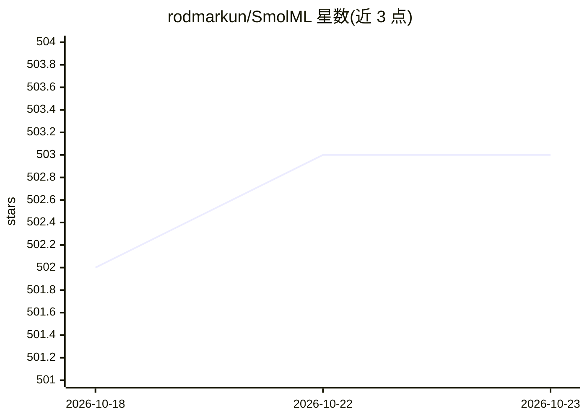

# rodmarkun/SmolML

⭐ 503 · Python · MIT · 推送 2026-07-22 · [GitHub](https://github.com/rodmarkun/SmolML) · 个人维护

**纯 Python 从零实现的机器学习教学库**

仅用 Python 标准库（collections/random/math）从零实现的机器学习库，面向教学与理解 ML 内部原理：包含自动微分引擎 Value、自研 N 维数组 MLArray、激活函数、损失函数、优化器（SGD/Adam/AdaGrad）、线性和多项式回归、前馈神经网络、决策树/随机森林、K-Means、分词器与预处理工具，并配套分主线/支线的阅读指南。作者声明代码以理解而非性能为目标，速度慢、内存占用高，明确不建议用于生产环境。通过 git clone 源码探索使用。

## 筛选速览

| 维度 | 判定 | 备注 |
|---|---|---|
| AI 角色 | `ai-native` | 本体是模型或模型工具 |
| 许可风险 | `permissive` | MIT |
| 部署形态 | `library` | 以包/库形式分发 |
| 模型依赖 | — | README 未给出锁定关系 |
| 硬件要求 | — | 无带数字的原话,不猜 |
| 安装摩擦 | `low` | 无编译、无系统依赖或容器化 |
| 成熟度 | — | 结构信号不足 |

## 能力要点

- 仅依赖 Python 标准库，无 NumPy/SciPy/C++ 扩展
- 自研自动微分引擎（Value）与 N 维数组（MLArray）
- 覆盖回归、神经网络、决策树/随机森林、K-Means、SVM 等经典模型
- 配套主线/支线式分节阅读指南与 tests 目录

## 适用场景

- 逐步阅读代码理解自动微分、反向传播等 ML 底层机制
- 按指南自己动手复现 ML 组件以学习原理
- 在小数据集/玩具问题上观察经典算法行为

## 场景标签

`教程课程` · 领域:学习与行业

## 证据(README 行号)

> L3:  SmolML is a pure Python machine learning library built entirely from the ground up for educational purposes. Made t
> L10: SmolML is a fully functional (though *simplified*) machine learning library built using **only pure Python** and ba
> L72: SmolML is built for **learning**, and thus it should not be used for production. Being pure Python, it's **WAAAAY**

## 星数曲线

2026-10-18 502 → 2026-10-23 503（+1）

---
*卡片 v1 · prompt 1.4 · 生成 2026-10-21 · 置信度 mid · 依据 README sha `79b54233ccec` · [字段定义](../../DATASET.md)*
