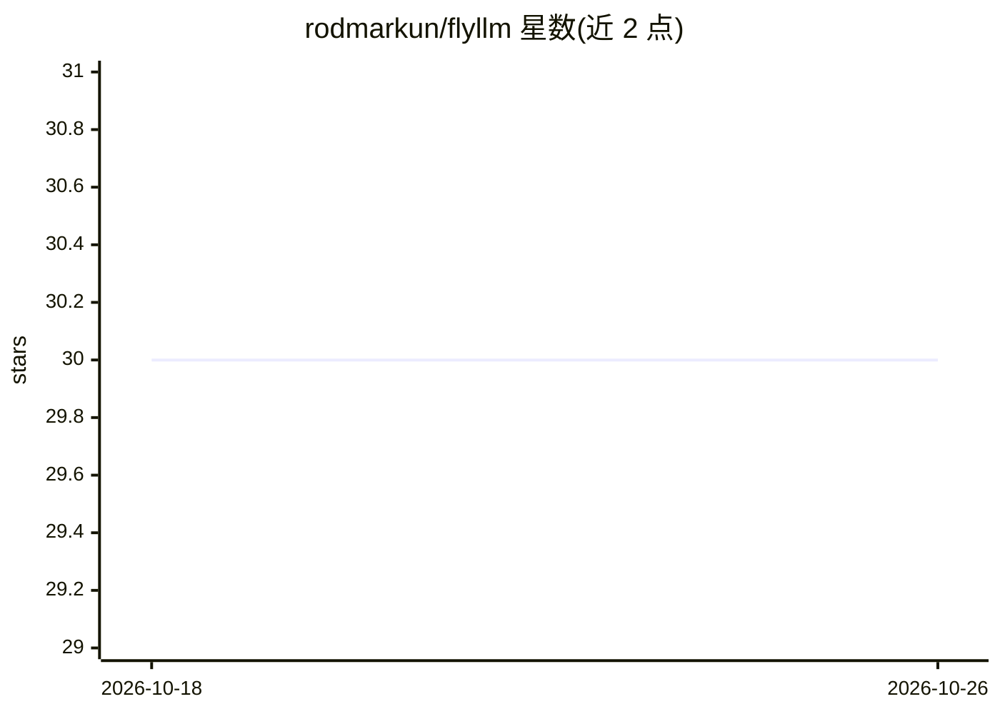

# rodmarkun/flyllm

⭐ 30 · Rust · MIT · 推送 2026-01-01 · [GitHub](https://github.com/rodmarkun/flyllm) · [官网](https://crates.io/crates/flyllm) · 个人维护

**Rust 的多 LLM 后端统一客户端库：负载均衡与故障转移**

以 LLMManager 为核心的 Rust 库，将 OpenAI、Anthropic、Google、Mistral、Ollama、Groq、Cohere、Together AI、Perplexity、LM Studio 十个提供商统一到一套 API 下，支持任务路由、按 LRU/最低延迟/随机策略在多实例间负载均衡、重试与自动故障转移、并行批处理与流式响应。配置可走 Builder 模式或 TOML 文件加环境变量，另含 token 用量统计、JSON 调试日志、可选 Prometheus 指标与 Grafana 监控面板。以 crates.io 依赖形式集成进 tokio 异步运行时使用。

## 筛选速览

| 维度 | 判定 | 备注 |
|---|---|---|
| AI 角色 | `ai-ecosystem` | LLM/agent 周边工具 |
| 许可风险 | `permissive` | MIT |
| 部署形态 | `None` |  |
| 模型依赖 | local-ok | 支持本地模型 |
| 硬件要求 | — | 无带数字的原话,不猜 |
| 安装摩擦 | `low` | 无编译、无系统依赖或容器化 |
| 成熟度 | — | 结构信号不足 |

## 能力要点

- 统一接口接入 10 个 LLM 提供商并全部支持流式响应
- 任务路由与多实例负载均衡（lru/lowest_latency/random 策略）
- 重试机制与跨实例自动故障转移
- 可选 Prometheus 指标与预构建 Grafana 监控面板

## 适用场景

- 在 Rust 应用中用统一 API 调用多个 LLM 提供商
- 用不同 API key 的多实例分担请求以规避限流
- 按任务类型为不同模型配置默认参数并路由请求

## 场景标签

 · 领域:LLM 基础设施

## 证据(README 行号)

> L3: FlyLLM is a Rust library that provides a load-balanced, multi-provider client for Large Language Models. It enables 
> L9: - **Multiple Provider Support** 🌐: Currently we support a unified interface for OpenAI, Anthropic, Google, Mistral, 
> L40: When your application sends a generation request (`GenerationRequest`), the manager automatically selects an approp

## 星数曲线

2026-10-18 30 → 2026-10-26 30（+0）

---
*卡片 v1 · prompt 1.4 · 生成 2026-10-26 · 置信度 high · 依据 README sha `282469aba98c` · [字段定义](../../DATASET.md)*
