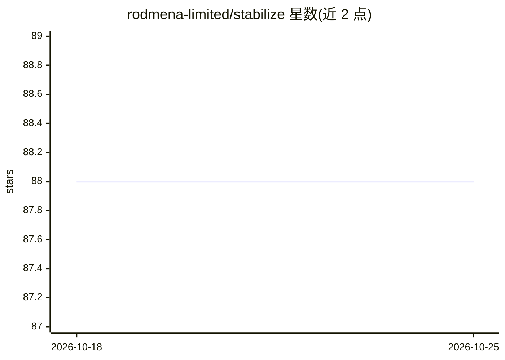

# rodmena-limited/stabilize

⭐ 88 · Python · Apache-2.0 · 推送 2026-10-13 · [GitHub](https://github.com/rodmena-limited/stabilize) · [官网](https://stabilize.readthedocs.io) · 组织维护

**面向 agentic 系统的 Python 持久化 DAG 工作流引擎**

以库形式嵌入进程运行的持久化工作流引擎：将工作描述为 stage 组成的有向无环图，每步在单事务中提交状态与推进消息，崩溃后从断点恢复，事件日志支持回放审计。运行于 SQLite 或 PostgreSQL，无独立服务器。面向构建 LLM agent 系统的开发者，附带 provider 无关的 LLM 客户端、ReAct 工具调用任务、可持续化挂起的人工审批、流式进度与 fan-in reducer，并内置 Shell/HTTP/Docker/SSH 等通用任务。需 Python 3.11+。

## 筛选速览

| 维度 | 判定 | 备注 |
|---|---|---|
| AI 角色 | `ai-ecosystem` | LLM/agent 周边工具 |
| 许可风险 | `permissive` | Apache-2.0 |
| 部署形态 | `library` | 以包/库形式分发 |
| 模型依赖 | local-ok | 支持本地模型 |
| 硬件要求 | — | 无带数字的原话,不猜 |
| 安装摩擦 | `low` | 无编译、无系统依赖或容器化 |
| 成熟度 | — | 结构信号不足 |

## 能力要点

- 单事务提交状态与消息，崩溃后精确恢复在途工作
- 支持 k-of-n 仲裁、先到先得、互斥、里程碑、有界循环等控制流模式
- ReAct 工具调用 agent、人工审批、事件流式与回放为内置构件
- 内置 Shell/HTTP/Python/Docker/SSH/子工作流任务

## 适用场景

- 构建崩溃后可断点续跑的多 agent 研究流水线
- 在 agent 工作流中插入需要人工审批的持久化关卡
- 用同一图模型编排 CI、数据处理等非 LLM 流水线

## 场景标签

`多智能体` `工作流自动化` `Agent 框架` · 领域:Agent 开发

## 证据(README 行号)

> L3: Stabilize is a durable workflow engine for Python. You describe work as a
> L10: The engine was built for reliable orchestration in general, and it turns out to
> L15: agentic workflows, from a single model call to a multi-agent system, but the

## 星数曲线

2026-10-18 88 → 2026-10-25 88（+0）

---
*卡片 v1 · prompt 1.4 · 生成 2026-10-23 · 置信度 high · 依据 README sha `6181b89e935d` · [字段定义](../../DATASET.md)*
