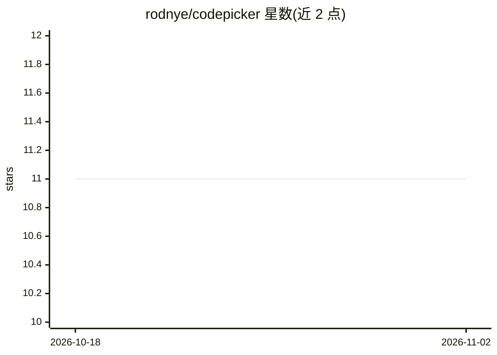

# rodnye/codepicker

⭐ 11 · TypeScript · MIT · 推送 2026-09-05 · [GitHub](https://github.com/rodnye/codepicker) · [官网](http://rodny.is-a.dev/codepicker/) · 个人维护

**把代码库转 Markdown 供 LLM 使用、并逆向写回的 CLI**

Node.js 命令行工具 codepicker，双向转换代码与 Markdown：pick 命令按 glob 模式提取代码片段为结构化 Markdown（可复制到剪贴板、限制行数、显示行号、读取远程仓库），apply 命令将 LLM 回复中的 codepick 格式代码块写回文件，忽略代码块外的解释文本。面向在真实项目上与 LLM 协作的开发者，也可用作代码备份/恢复工具。通过 npm 全局安装，遵循 .gitignore 规则，二进制文件以元数据替代。

## 筛选速览

| 维度 | 判定 | 备注 |
|---|---|---|
| AI 角色 | `ai-ecosystem` | LLM/agent 周边工具 |
| 许可风险 | `permissive` | MIT |
| 部署形态 | `library` | 以包/库形式分发 |
| 模型依赖 | — | README 未给出锁定关系 |
| 硬件要求 | — | 无带数字的原话,不猜 |
| 安装摩擦 | `low` | 无编译、无系统依赖或容器化 |
| 成熟度 | — | 结构信号不足 |

## 能力要点

- pick/apply 双向转换：代码 → Markdown → 代码
- -D 附加 codepick 格式规范文档，引导模型按格式回复
- 支持从远程仓库读取代码（--remote/--remote-branch）
- apply 容错解析：仅提取代码块，丢弃解释文本

## 适用场景

- 把项目局部代码一次性粘贴给 ChatGPT 等 LLM 请求修改
- 将 LLM 回复的完整文件内容写回本地项目
- 用 Markdown 文件做代码快照备份与恢复

## 场景标签

 · 领域:开发者工具/LLM 工作流

## 证据(README 行号)

> L19: `codepicker` is a **bidirectional CLI** that turns your codebase into structured Markdown—and back again!
> L21: It’s designed to make working with LLMs on real projects **fast and predictable**. Instead of juggling files manual
> L111: ### 2. Ask your LLM

## 星数曲线

2026-10-18 11 → 2026-11-02 11（+0）

---
*卡片 v1 · prompt 1.4 · 生成 2026-11-02 · 置信度 high · 依据 README sha `07de0ae846c7` · [字段定义](../../DATASET.md)*
