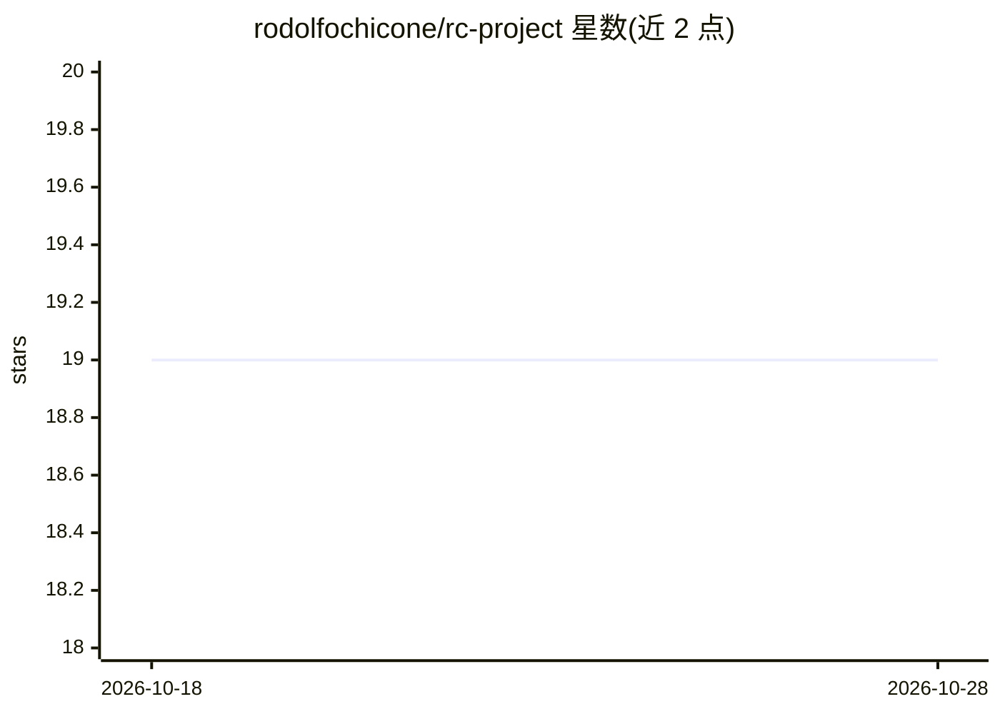

# rodolfochicone/rc-project

⭐ 19 · JavaScript · MIT · 推送 2026-08-06 · [GitHub](https://github.com/rodolfochicone/rc-project) · [官网](https://rodolfochicone.dev) · 个人维护

**Claude Code 的工程化 skills/agents/hooks 插件：从想法到 PR**

面向 Claude Code 等 agent 宿主的插件，由三类原语组成：17 个 skills（规格访谈、拆票、TDD、代码评审、git 开 PR 等）、4 个 council 类 agents（上下文隔离的多视角评审）、10 个 hooks（确定性防护：拒绝破坏性 git、默认只读数据库、提交前验证等）。所有产物为项目 `.rc/` 下的纯 markdown，各阶段读写 `.rc/tasks/<slug>/` 中的文件衔接。描述预算控制在约 540 tokens；通过 `/plugin marketplace add` 安装，附冒烟测试与 HTML/PDF 手册。

## 筛选速览

| 维度 | 判定 | 备注 |
|---|---|---|
| AI 角色 | `ai-ecosystem` | LLM/agent 周边工具 |
| 许可风险 | `permissive` | MIT |
| 部署形态 | `None` |  |
| 模型依赖 | — | README 未给出锁定关系 |
| 硬件要求 | — | 无带数字的原话,不猜 |
| 安装摩擦 | `low` | 无编译、无系统依赖或容器化 |
| 成熟度 | — | 结构信号不足 |

## 能力要点

- idea→spec→tickets→implement→review→PR 的 skill 链路
- 10 个确定性 hooks（git/commit/db 防护、验证戳、memory 记录），fail-open
- skill 描述预算管控：17 个 skills 约 540 tokens/会话，冒烟测试强制
- 4 个 council archetype agents 做对抗性评审

## 适用场景

- 在 Claude Code 中按工程流程从需求走到 PR
- 用 hooks 防止 agent 执行破坏性 git 操作或未验证提交
- 让 agent 记录并复用项目经验（rc-memory）

## 场景标签

`代码审查` `Agent 框架` · 领域:Agent 开发

## 证据(README 行号)

> L6: RC is an **agent plugin** — three primitives, no more: **skills**, **agents**, **hooks**. It runs
> L69: idea → rc-spec → rc-tickets → rc-implement ⇄ rc-tdd → rc-code-review → rc-git → PR
> L243: Claude Code is the shipped channel. Nothing in the set depends on a host-exclusive tool — the gate

## 星数曲线

2026-10-18 19 → 2026-10-28 19（+0）

---
*卡片 v1 · prompt 1.4 · 生成 2026-10-28 · 置信度 high · 依据 README sha `56801895a391` · [字段定义](../../DATASET.md)*
