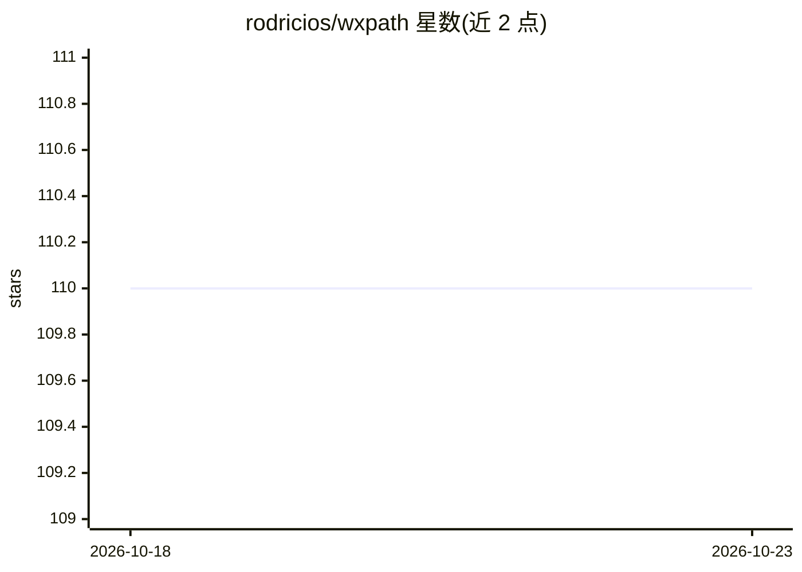

# rodricios/wxpath

⭐ 110 · Python · AGPL-3.0 · 推送 2026-09-30 · [GitHub](https://github.com/rodricios/wxpath) · 个人维护

**用单条 XPath 表达式声明式描述 Web 爬取与抽取的 Python 库**

面向开发者的声明式爬虫库：通过自定义 url(...) 运算符与 ///url(...) 深爬语法，把遍历与抽取合并进一条 XPath 3.1 表达式，引擎负责调度、并发与去重，结果以流式产出 asyncio/aiohttp 优先。输出结构化对象（lxml 节点、字典、带来源的字符串等），CLI 输出 JSON，可供电台 LLM/RAG 管线使用；遍历本身确定性、不依赖 LLM。默认遵守 robots.txt，可选 SQLite/Redis 持久化缓存，提供 TUI、Hooks、进度条。不支持的包括浏览器渲染与自动代理轮换；项目自述处于早期开发阶段，API 可能变化。AGPL-3.0 许可，作者另提供商业化咨询联系方式。

## 筛选速览

| 维度 | 判定 | 备注 |
|---|---|---|
| AI 角色 | `ai-enhanced` | 去掉 AI 部分产品仍成立 |
| 许可风险 | `viral` | AGPL-3.0 |
| 部署形态 | `library` | 以包/库形式分发 |
| 模型依赖 | — | README 未给出锁定关系 |
| 硬件要求 | — | 无带数字的原话,不猜 |
| 安装摩擦 | `low` | 无编译、无系统依赖或容器化 |
| 成熟度 | `idea` | |

## 能力要点

- url(...) 与 ///url(...) 语法将遍历与抽取合入单条 XPath 表达式，引擎处理调度、并发与去重
- XPath 3.1 支持（elementpath 库），输出结构化对象供管线消费
- asyncio/aiohttp 优先，提供同步包装 API、CLI 与 Textual TUI
- 可选 SQLite/Redis 缓存后端、Hooks 系统与默认 robots.txt 遵守

## 适用场景

- 用一条表达式递归爬取站点并抽取结构化字段，替代手写爬取循环
- 为 RAG/LLM 管线准备干净的 JSON 层级数据
- 暂停后恢复大规模爬取（持久化缓存）

## 场景标签

`网页抓取` · 领域:效率与自动化

## 证据(README 行号)

> L56: Extract clean, structured JSON hierarchies directly from the graph - feed your LLMs signal, not noise. Refer to Lan
> L60: **wxpath** is deterministic (read: not powered by LLMs). While we can't guarantee the network is stable, we can gua

## 星数曲线

2026-10-18 110 → 2026-10-23 110（+0）

---
*卡片 v1 · prompt 1.4 · 生成 2026-10-23 · 置信度 mid · 依据 README sha `b7f6ed69d05b` · [字段定义](../../DATASET.md)*
