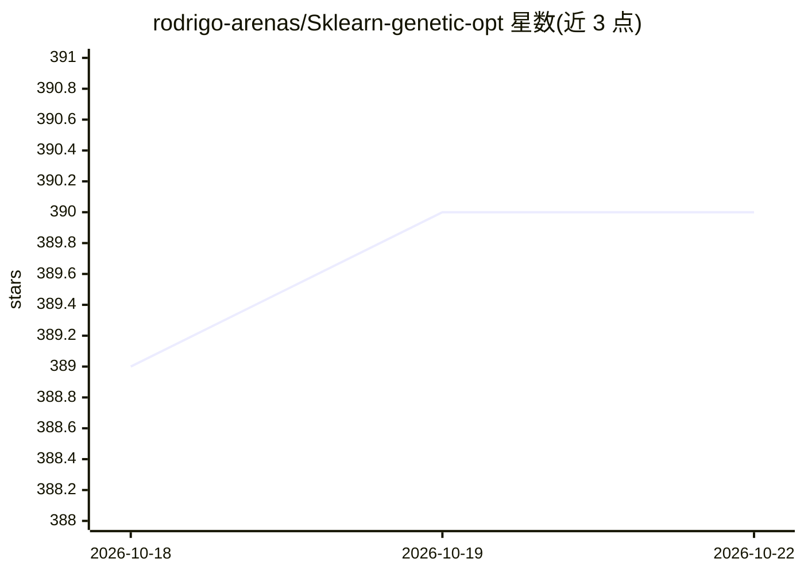

# rodrigo-arenas/Sklearn-genetic-opt

⭐ 390 · Python · MIT · 推送 2026-10-18 · [GitHub](https://github.com/rodrigo-arenas/Sklearn-genetic-opt) · [官网](https://sklearngeneticopt.rodrigo-arenas.com) · 个人维护

**用遗传算法为 scikit-learn 模型做超参调优与特征选择的工具库**

面向使用 scikit-learn 的机器学习从业者的优化工具包，提供 GASearchCV（超参搜索）与 GAFeatureSelectionCV（基于交叉验证的包装式特征选择），自称 GridSearchCV/RandomizedSearchCV 的进化算法替代方案。遗传算法评估完整参数配置并用优质候选引导后续代际；支持混合搜索空间（Integer/Continuous/Categorical）、拉丁超立方初始化、warm-start、早停回调、自适应交叉/变异率调度、n_jobs 并行、优化历史与可视化，并可集成 MLflow 记录候选评估。README 也列出不适用情形：小网格、极廉价拟合或需分布式优化时建议改用 GridSearchCV 或 Optuna。

## 筛选速览

| 维度 | 判定 | 备注 |
|---|---|---|
| AI 角色 | `ai-ecosystem` | LLM/agent 周边工具 |
| 许可风险 | `permissive` | MIT |
| 部署形态 | `library` | 以包/库形式分发 |
| 模型依赖 | — | README 未给出锁定关系 |
| 硬件要求 | — | 无带数字的原话,不猜 |
| 安装摩擦 | `low` | 无编译、无系统依赖或容器化 |
| 成熟度 | — | 结构信号不足 |

## 能力要点

- GASearchCV 兼容 scikit-learn API（fit/predict/best_params_），可搭配任意 sklearn 估计器与评分
- GAFeatureSelectionCV 以交叉验证评估特征子集，可与调优组成两阶段流程
- 支持混合参数空间、拉丁超立方播种、warm-start 与重复配置规避
- 内置早停回调（ConsecutiveStopping/DeltaThreshold/TimerStopping）与逐代适应度/多样性历史和可视化

## 适用场景

- 在大型混合或连续参数空间中做带交叉验证的超参调优
- 在统一工作流中同时完成特征选择与超参调优
- 从已知较优配置 warm-start 并跟踪逐代收敛过程（含 MLflow 记录）

## 场景标签

 · 领域:机器学习/模型优化

## 证据(README 行号)

> L10: Hyperparameter tuning and feature selection for scikit-learn models using genetic algorithms.
> L42: ``sklearn-genetic-opt`` is a scikit-learn-compatible optimization toolkit for users
> L46: ``GAFeatureSelectionCV``, a wrapper-based selector that evaluates feature

## 星数曲线

2026-10-18 389 → 2026-10-22 390（+1）

---
*卡片 v1 · prompt 1.4 · 生成 2026-10-21 · 置信度 mid · 依据 README sha `48287b42be2f` · [字段定义](../../DATASET.md)*
