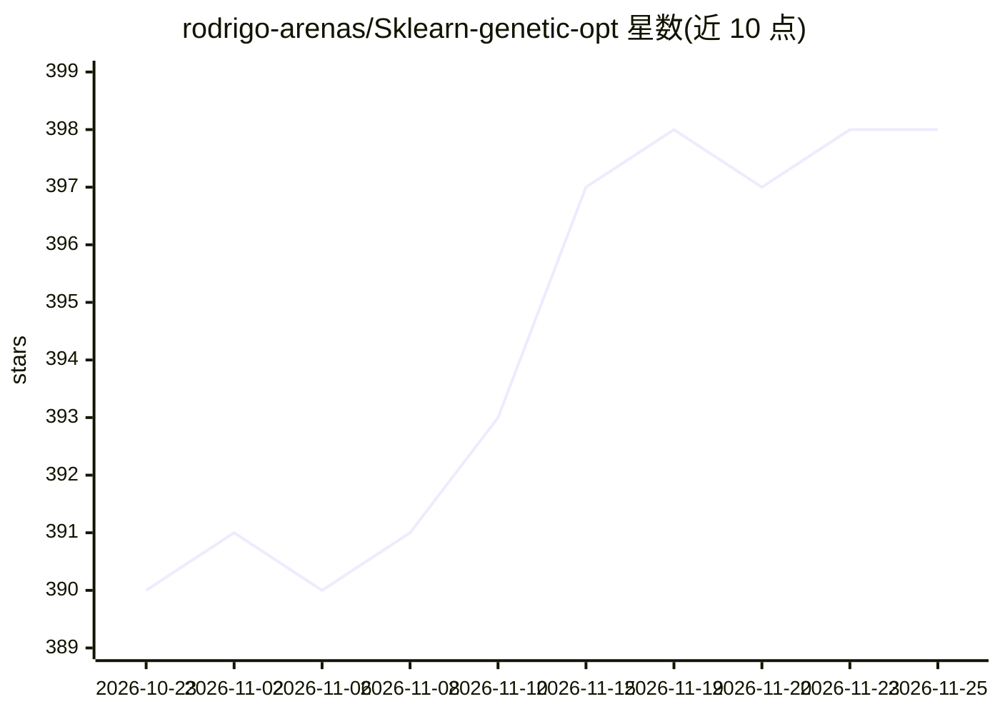

# rodrigo-arenas/Sklearn-genetic-opt

⭐ 398 · Python · MIT · 推送 2026-11-21 · [GitHub](https://github.com/rodrigo-arenas/Sklearn-genetic-opt) · [官网](https://sklearngeneticopt.rodrigo-arenas.com) · 个人维护

**scikit-learn 的进化算法超参搜索与特征选择库**

为 scikit-learn 估计器提供基于进化算法的超参数调优（GASearchCV）与特征选择（GAFeatureSelectionCV）：给定模型、评分器和预算，用交叉验证评估候选、拟合胜出组合并支持对新数据调用 predict。内置 DEAP 优化后端，另有 scipy、nevergrad、cmaes、pymoo 四个可选引擎（pip extra 安装），五个引擎均支持实时绘图、早停与按代恢复；提供 cv_results_ 与 history 检查搜索过程，附基准测试与引文元数据。适用于组合穷举代价过高的场景。

## 筛选速览

| 维度 | 判定 | 备注 |
|---|---|---|
| AI 角色 | `ai-native` | 本体是模型或模型工具 |
| 许可风险 | `permissive` | MIT |
| 部署形态 | `library` | 以包/库形式分发 |
| 模型依赖 | — | README 未给出锁定关系 |
| 硬件要求 | — | 无带数字的原话,不猜 |
| 安装摩擦 | `low` | 无编译、无系统依赖或容器化 |
| 成熟度 | — | 结构信号不足 |

## 能力要点

- GASearchCV 超参搜索与 GAFeatureSelectionCV 特征选择两类估计器
- DEAP 默认引擎加 scipy/nevergrad/cmaes/pymoo 四个可选优化后端
- 支持实时绘图、早停与从已完成代恢复
- cv_results_ 与 history 提供逐候选与逐代进展检查

## 适用场景

- 参数组合过大无法穷举搜索时为 sklearn 模型调参
- 为高维数据集筛选较小的特征子集
- 以相匹配的 CV 调用数对比不同优化器在九类工作负载上的表现

## 场景标签

 · 领域:机器学习工具/AutoML

## 证据(README 行号)

> L10: **Tune a scikit-learn estimator or find a smaller set of features.**
> L71: Version 0.16.0 includes DEAP by default and supports four optional engines.
> L106: Each optional engine has a pip extra with the same name. All five support

## 星数曲线

2026-10-23 390 → 2026-11-25 398（+8）

---
*卡片 v1 · prompt 1.4 · 生成 2026-11-25 · 置信度 high · 依据 README sha `d188a1637160` · [字段定义](../../DATASET.md)*
