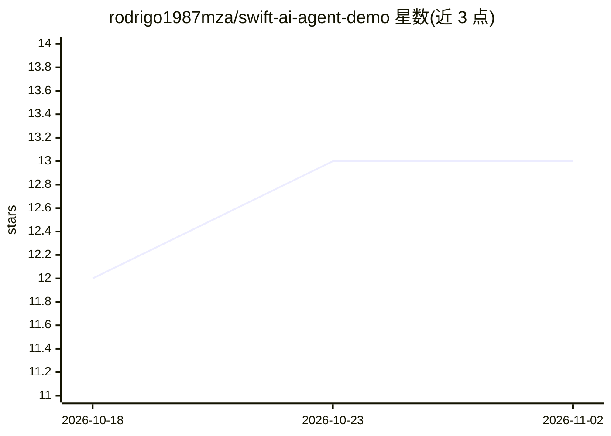

# rodrigo1987mza/swift-ai-agent-demo

⭐ 13 · Swift · MIT · 推送 2026-10-12 · [GitHub](https://github.com/rodrigo1987mza/swift-ai-agent-demo) · 个人维护

**iOS 开发者的 ReAct AI Agent 模式演示应用**

基于 SwiftUI 的原生 iOS 应用，演示 ReAct（推理+行动）AI agent 模式：用户输入问题后，可观察 agent 分步思考、行动与求解过程，内置预定义演示场景。通过调用 OpenAI GPT 模型实现自然语言交互，代码按 Model/View/ViewModel 分层组织，Model 层封装 agent 推理并对接 OpenAI API。定位为学习工具，面向关注 AI、自动化与移动开发的开发者。需 Xcode 13+ 与 macOS 11+ 环境从源码构建运行，另有 GitHub Releases 提供下载入口。

## 筛选速览

| 维度 | 判定 | 备注 |
|---|---|---|
| AI 角色 | `ai-native` | 本体是模型或模型工具 |
| 许可风险 | `permissive` | MIT |
| 部署形态 | `None` |  |
| 模型依赖 | — | README 未给出锁定关系 |
| 硬件要求 | — | 无带数字的原话,不猜 |
| 安装摩擦 | `low` | 无编译、无系统依赖或容器化 |
| 成熟度 | — | 结构信号不足 |

## 能力要点

- 演示 ReAct（推理+行动）agent 模式，可视化分步求解过程
- 集成 OpenAI GPT 模型实现自然语言交互
- SwiftUI 界面与 Model/View/ViewModel 分层架构
- 内置预定义演示场景

## 适用场景

- 学习如何在 iOS 应用中实现 ReAct agent 模式
- 观察 AI agent 的分步推理与工具使用过程
- 作为 Swift/SwiftUI 集成 OpenAI API 的参考实现

## 场景标签

 · 领域:移动开发/AI Agent 演示

## 证据(README 行号)

> L14: The **Swift AI Agent Demo** is a native iOS application that demonstrates the ReAct (Reasoning + Acting) AI agent p
> L25: - **OpenAI Integration**: Utilizes GPT models for natural language processing.

## 星数曲线

2026-10-18 12 → 2026-11-02 13（+1）

---
*卡片 v1 · prompt 1.4 · 生成 2026-10-31 · 置信度 high · 依据 README sha `77e77f4127ae` · [字段定义](../../DATASET.md)*
