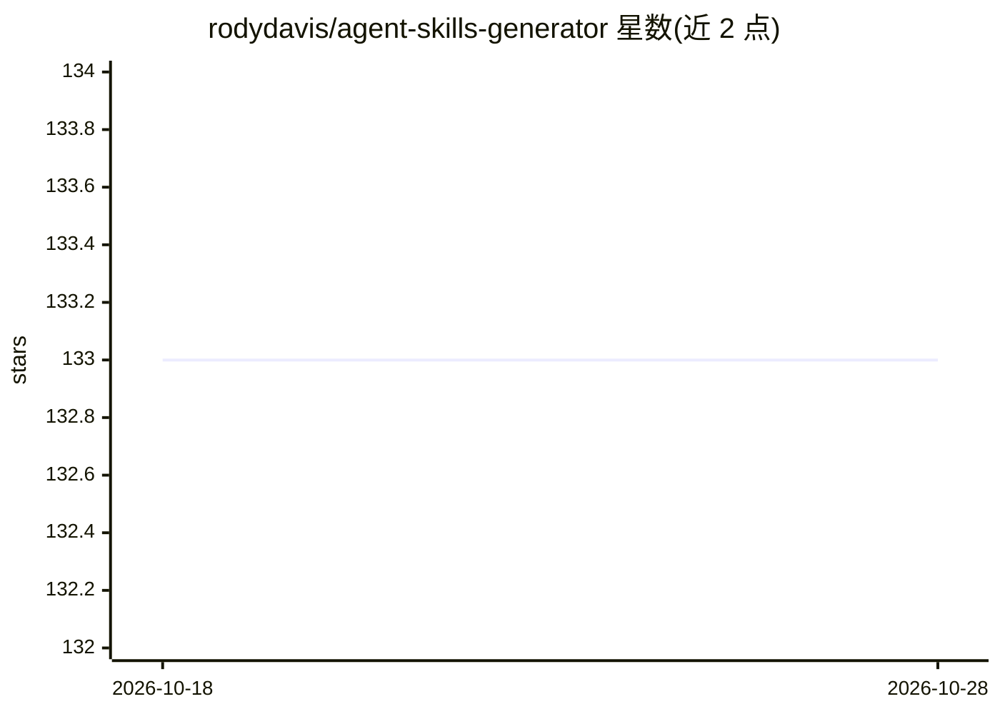

# rodydavis/agent-skills-generator

⭐ 133 · TypeScript · Apache-2.0 · 推送 2026-01-30 · [GitHub](https://github.com/rodydavis/agent-skills-generator) · 个人维护

**把文档网站抓取转换为面向 AI agent 的 Markdown 技能**

包含两个项目：VS Code 扩展与 Go CLI。VS Code 扩展提供 Agent Skills 侧边栏，以图形界面管理 URL 抓取规则（include/ignore、子路径）并一键生成技能，规则可导入导出 JSON。Go CLI 支持递归抓取文档网站、HTML 转 Markdown（面向 token 效率优化）、frontmatter 元数据（原始 URL、标题、日期）与可选扁平存储（用于 RAG）。面向为 agent 准备技能文档的开发者。

## 筛选速览

| 维度 | 判定 | 备注 |
|---|---|---|
| AI 角色 | `ai-ecosystem` | LLM/agent 周边工具 |
| 许可风险 | `permissive` | Apache-2.0 |
| 部署形态 | `library` | 以包/库形式分发 |
| 模型依赖 | — | README 未给出锁定关系 |
| 硬件要求 | — | 无带数字的原话,不猜 |
| 安装摩擦 | `low` | 无编译、无系统依赖或容器化 |
| 成熟度 | — | 结构信号不足 |

## 能力要点

- VS Code 扩展侧边栏可视化管理 URL 抓取规则并一键生成技能
- Go CLI 递归抓取与 HTML→Markdown 转换，面向 token 效率
- frontmatter 记录原始 URL、标题、日期
- 可选扁平存储结构（面向 RAG 场景）

## 适用场景

- 把框架官方文档转成 AI agent 可用的技能文件
- 为 RAG 知识库批量准备干净的 Markdown 文档
- 在 VS Code 内管理多站点抓取规则并复用配置

## 场景标签

`网页抓取` · 领域:效率与自动化

## 证据(README 行号)

> L3: Convert documentation websites into Markdown skills optimized for AI agents and LLMs.
> L13: A Visual Studio Code extension that provides a dedicated "Agent Skills" side panel to manage your crawling rules an

## 星数曲线

2026-10-18 133 → 2026-10-28 133（+0）

---
*卡片 v1 · prompt 1.4 · 生成 2026-10-22 · 置信度 mid · 依据 README sha `1e738db01495` · [字段定义](../../DATASET.md)*
