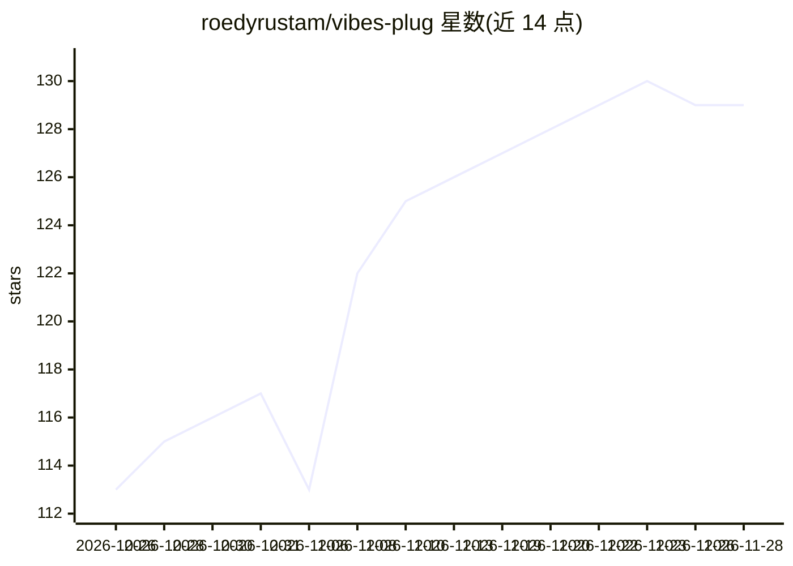

# roedyrustam/vibes-plug

⭐ 129 · JavaScript · MIT · 推送 2026-11-27 · [GitHub](https://github.com/roedyrustam/vibes-plug) · [官网](https://roedyrustam.github.io/vibes-plug/) · 个人维护

**为 AI 编程 IDE 提供 179 技能与 8 子代理的插件**

以 npm 包与安装脚本分发的 AI 代理插件：面向 Antigravity、Claude Code、Cursor、Windsurf、OpenAI Codex、Trae 等 IDE，注入 179 个领域技能（前端、后端、AI/MCP、FinTech、测试安全、DevOps 等 6 大类）与 9 个专职子代理（swarm-architect、quality-guardian 等），通过 Fan-Out/Fan-In 与 Critic-Validator 循环协调；另含 P1–P7 工程引擎（KV-Cache 前缀编译、内存 SQLite 沙箱、AST 检查、SMT 不变量验证、WASM 沙箱）与 MCP v1.x 服务器。支持 `vibes create-agent` 自定义子代理，可打包为单二进制分发。

## 筛选速览

| 维度 | 判定 | 备注 |
|---|---|---|
| AI 角色 | `ai-ecosystem` | LLM/agent 周边工具 |
| 许可风险 | `permissive` | MIT |
| 部署形态 | `desktop` | 安装包/桌面程序 |
| 模型依赖 | — | README 未给出锁定关系 |
| 硬件要求 | — | 无带数字的原话,不猜 |
| 安装摩擦 | `low` | 无编译、无系统依赖或容器化 |
| 成熟度 | — | 结构信号不足 |

## 能力要点

- 179 个领域技能按 6 类组织，由 swarm-architect 等 9 个子代理协调
- 内置 Stdio/SSE MCP v1.x 服务器，提供 42 个工具与 Profile Masking
- P1–P7 引擎：前缀缓存编译、SQLite 沙箱、AST 分析、SMT/Z3 验证、WASM 沙箱
- 一行 shell 安装器与 `vibes package:binary` 单二进制分发

## 适用场景

- 在 Cursor/Claude Code 等 IDE 中启用多代理协调的全栈开发流程
- 为项目生成定制子代理与平台规则文件
- 通过 MCP 服务器向代理暴露 42 个工具
- 代码交付前的反低质量扫描与技术债审计

## 场景标签

`编码 Agent` `多智能体` `提示工程` · 领域:Agent 开发

## 证据(README 行号)

> L5: **Turn any IDE into an autonomous 179-agent software development studio.**
> L50: |**Native MCP Server**|❌ None|❌ None|🔌 **Stdio & SSE MCP v1.x Server with 42 Frontier Tools & Profile Masking**|
> L56: VibesPlug Pro is powered by **179 specialized AI domain skills**, coordinated autonomously by the master ideation o

## 星数曲线

2026-10-26 113 → 2026-11-28 129（+16）

---
*卡片 v1 · prompt 1.4 · 生成 2026-11-28 · 置信度 mid · 依据 README sha `db0faf65a349` · [字段定义](../../DATASET.md)*
