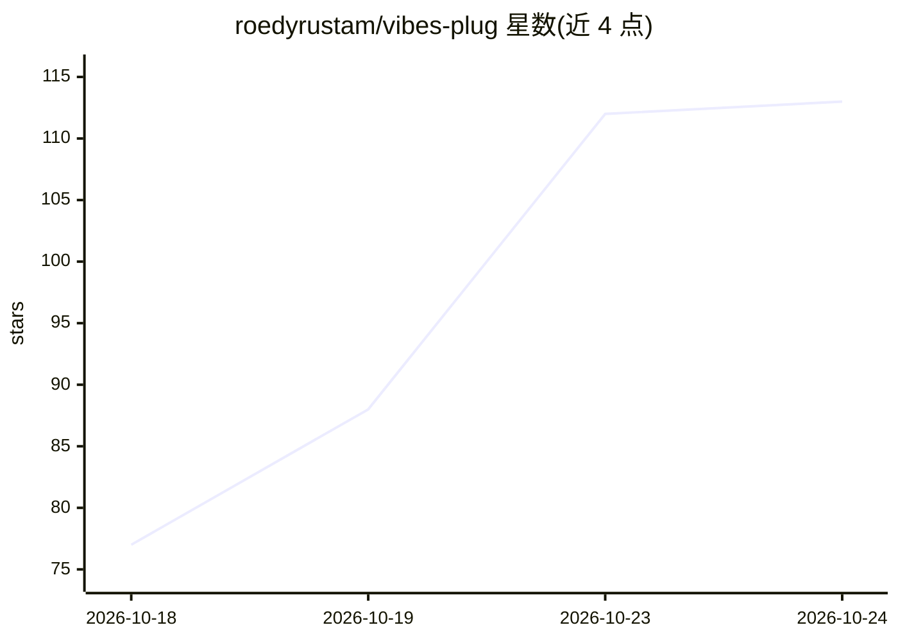

# roedyrustam/vibes-plug

⭐ 113 · JavaScript · MIT · 推送 2026-10-23 · [GitHub](https://github.com/roedyrustam/vibes-plug) · [官网](https://www.npmjs.com/package/vibes-plug) · 个人维护

**跨 IDE 的 161 技能 AI agent 集合与编排工具**

面向全栈开发工作流的 AI 技能/子代理集合：提供 161 个领域技能（前端、后端、AI/MCP、FinTech、测试安全、DevOps 等），由编排技能协调，并内置 5 个专职子代理。附带 CLI（vibes）实现技能注入、自定义 agent 生成、AST 检查、内存 SQLite 沙箱评估、PRM 代码仲裁、SMT 不变量验证等 P1–P6 引擎，并提供原生 MCP v1.x 服务器（14+ 工具）。支持 Antigravity、Cursor、Claude Code、Codex、Windsurf、Trae 等多种 IDE，通过 npx 一条命令初始化。限制：功能描述以自述为主，README 未给出运行环境硬性要求。

## 筛选速览

| 维度 | 判定 | 备注 |
|---|---|---|
| AI 角色 | `ai-ecosystem` | LLM/agent 周边工具 |
| 许可风险 | `permissive` | MIT |
| 部署形态 | `desktop` | 安装包/桌面程序 |
| 模型依赖 | — | README 未给出锁定关系 |
| 硬件要求 | — | 无带数字的原话,不猜 |
| 安装摩擦 | `low` | 无编译、无系统依赖或容器化 |
| 成熟度 | — | 结构信号不足 |

## 能力要点

- 161 个领域技能按 6 大类组织，含目录生成（vibes docs）
- 原生 MCP v1.x 服务器（stdio JSON-RPC 2.0 与 SSE，14+ 工具）
- P1–P6 引擎：prompt 前缀编译、内存 SQLite 沙箱、AST 检查、PRM 仲裁、SMT 不变量验证、WASM/VM 沙箱
- 支持 Antigravity/Cursor/Claude Code/Codex/Windsurf/Trae 多 IDE 接入

## 适用场景

- 为我的 IDE 注入一组全栈开发的专家技能与子代理
- 通过 MCP 服务器在 Claude Desktop/Cursor 中调用 AST 查询、SQL 沙箱评估等工具
- 按项目定制子代理并绑定所需技能

## 场景标签

`多智能体` `提示工程` `Agent 框架` · 领域:Agent 开发

## 证据(README 行号)

> L5: **Turn any IDE into an autonomous 161-agent software development studio.**
> L48: VibesPlug Pro is powered by **161 specialized AI domain skills**, coordinated autonomously by the master ideation o

## 星数曲线

2026-10-18 77 → 2026-10-24 113（+36）

---
*卡片 v1 · prompt 1.4 · 生成 2026-10-23 · 置信度 high · 依据 README sha `14ccf2358c8f` · [字段定义](../../DATASET.md)*
