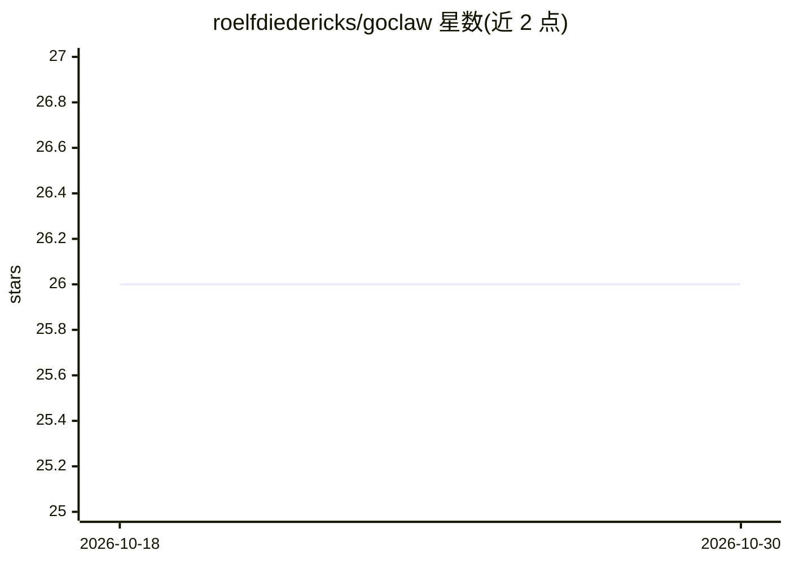

# roelfdiedericks/goclaw

⭐ 26 · Go · NOASSERTION · 推送 2026-04-23 · [GitHub](https://github.com/roelfdiedericks/goclaw) · [官网](https://goclaw.org) · 个人维护

**Go 编写的 AI agent 网关：多渠道对话与持久记忆**

OpenClaw 的 Go 语言实现，兼容其会话格式，可与之并行运行或独立运行。作为 AI agent 网关，提供 Telegram/WhatsApp/HTTP/TUI/实时语音渠道；核心机制包括跨上下文压缩的转录检索、长期记忆召回、从对话提取实体关系的语义记忆图（SQLite+向量扩展存储）、托管 Chromium 浏览器、子代理并发执行与 LLM 按用途路由及自动故障切换。支持 Anthropic/OpenAI/Ollama/xAI 等文本提供商与多种语音转写后端，含工具沙箱与提示注入防护。

## 筛选速览

| 维度 | 判定 | 备注 |
|---|---|---|
| AI 角色 | `ai-ecosystem` | LLM/agent 周边工具 |
| 许可风险 | `none` | NOASSERTION |
| 部署形态 | `None` |  |
| 模型依赖 | local-ok | 支持本地模型 |
| 硬件要求 | — | 无带数字的原话,不猜 |
| 安装摩擦 | `low` | 无编译、无系统依赖或容器化 |
| 成熟度 | — | 结构信号不足 |

## 能力要点

- 跨上下文压缩的转录检索与可展开的长期记忆召回
- 语义记忆图：自动抽取实体/事实/关系，提供 recall/store/query 工具
- 多渠道接入：Telegram、WhatsApp、HTTP、实时语音（xAI）、TUI
- 按用途的 LLM 路由链（agent/summarization/embeddings）带自动故障切换，含成本追踪

## 适用场景

- 通过 Telegram/WhatsApp/网页长期与个人 AI agent 对话且不丢失历史
- 让 agent 在数周后的对话中检索早期决策与细节
- 本地化部署 agent 网关并按用途混用云端与本地（Ollama）模型

## 场景标签

`Agent 记忆` `语音 Agent` `模型网关` · 领域:Agent 开发

## 证据(README 行号)

> L2: description: "GoClaw is a Golang AI agent gateway with transcript search, multi-channel support, and persistent memo
> L11: Originally intended as a "minimum viable" replacement for OpenClaw, it has molted to reasonable feature parity with
> L15: Telegram, WhatsApp, HTTP (web), real-time voice (via xAI), and TUI interfaces are available for chatting to GoClaw.

## 星数曲线

2026-10-18 26 → 2026-10-30 26（+0）

---
*卡片 v1 · prompt 1.4 · 生成 2026-10-26 · 置信度 high · 依据 README sha `4a3a4ffb284d` · [字段定义](../../DATASET.md)*
