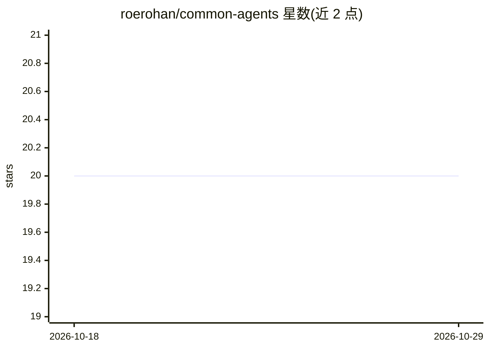

# roerohan/common-agents

⭐ 20 · TypeScript · MIT · 推送 2025-11-23 · [GitHub](https://github.com/roerohan/common-agents) · [官网](https://npmjs.com/package/common-agents) · 个人维护

**基于 Cloudflare Agents SDK 的多 agent 复用框架**

构建在 Cloudflare Agents SDK 之上的多 agent 框架，以 TypeScript 基类形式提供两类 agent：持久型（CoordinatorAgent、RouterAgent、SchedulerAgent、KnowledgeBaseAgent 等）与临时自毁型（WorkerAgent、LLMToolAgent 等），支持生命周期钩子、重试与并发控制的 worker 池，附带邮件处理、LLM 文档摘要、定时 ETL 三个完整示例。面向在 Cloudflare Workers/Durable Objects 上开发多 agent 系统的开发者，需 Node.js ≥18、TypeScript ≥5 与 Cloudflare 账户，README 标注 Beta，API 可能变更。

## 筛选速览

| 维度 | 判定 | 备注 |
|---|---|---|
| AI 角色 | `ai-ecosystem` | LLM/agent 周边工具 |
| 许可风险 | `permissive` | MIT |
| 部署形态 | `library` | 以包/库形式分发 |
| 模型依赖 | — | README 未给出锁定关系 |
| 硬件要求 | — | 无带数字的原话,不猜 |
| 安装摩擦 | `low` | 无编译、无系统依赖或容器化 |
| 成熟度 | `idea` | |

## 能力要点

- 持久型/临时型两类 agent 基类（协调、路由、调度、知识库、LLM 工具等 11 种文档化类型）
- 生命周期管理钩子、重试逻辑与并发控制的 worker 池
- 三个完整可运行示例（邮件流水线、LLM 摘要 fan-out/fan-in、定时 ETL）
- Cloudflare Workers/Durable Objects 原生构建

## 适用场景

- 在 Cloudflare 上搭建多 agent 协作/分发工作流
- 用现成基类实现协调者-工人模式或 fan-out/fan-in 流水线
- 为 LLM 调用提供带对话历史与工具调用的 agent 封装

## 场景标签

`Agent 框架` `多智能体` · 领域:Agent 开发

## 证据(README 行号)

> L7: A production-ready multi-agent framework built on top of the Cloudflare Agents SDK. Available on npm as `common-agen
> L123: **LLMToolAgent** - Ephemeral agent for LLM API integration with conversation history and tool calling support.
> L167: Built on Cloudflare Agents SDK, this framework provides:

## 星数曲线

2026-10-18 20 → 2026-10-29 20（+0）

---
*卡片 v1 · prompt 1.4 · 生成 2026-10-28 · 置信度 high · 依据 README sha `b1859215ae01` · [字段定义](../../DATASET.md)*
