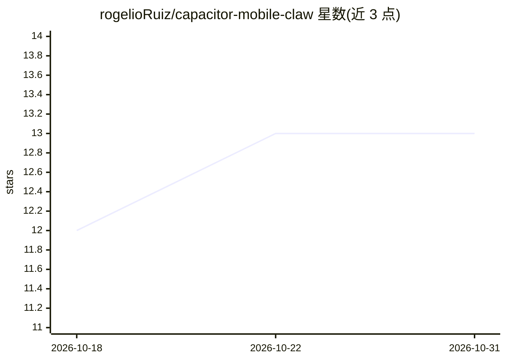

# rogelioRuiz/capacitor-mobile-claw

⭐ 13 · TypeScript · MIT · 推送 2026-06-22 · [GitHub](https://github.com/rogelioRuiz/capacitor-mobile-claw) · [官网](https://github.com/rogelioRuiz/capacitor-mobile-claw#try-it--reference-app) · 个人维护

**移动端设备上运行 Claude agent 的 Capacitor 插件引擎**

面向移动应用开发者的 Capacitor 插件：通过 WebView 桥接封装 Rust 原生 agent 运行时（capacitor-native-agent），在手机本地运行 Claude LLM 调用、文件工具、沙箱代码执行（JS/Pyodide）、git 操作及可扩展的 MCP 设备工具，无云端中转。附带 LanceDB 设备端向量记忆、基于 WorkManager/BGTaskScheduler 的后台调度、心跳与 cron 任务，以及工具执行审批门。认证走 Anthropic API key 或 Claude Max OAuth PKCE。提供 npm 安装与含 Vue 3 界面的参考应用。

## 筛选速览

| 维度 | 判定 | 备注 |
|---|---|---|
| AI 角色 | `ai-ecosystem` | LLM/agent 周边工具 |
| 许可风险 | `permissive` | MIT |
| 部署形态 | `library` | 以包/库形式分发 |
| 模型依赖 | locked-api |  |
| 硬件要求 | — | 无带数字的原话,不猜 |
| 安装摩擦 | `medium` | 含编译或系统依赖之一 |
| 成熟度 | — | 结构信号不足 |

## 能力要点

- Rust 原生 agent 运行时，WebView 层仅做 UI 与桥接
- LanceDB 设备端向量记忆（存储/去重/语义召回）
- 文件工具、沙箱代码执行（JS/Python）、isomorphic-git、MCP 设备工具扩展
- 后台调度：心跳检查与 cron 任务（WorkManager/BGTaskScheduler）

## 适用场景

- 在自己的 Android/iOS 应用中嵌入本地运行的 AI agent
- 为 agent 添加设备能力工具（相机、传感器、SSH 等 MCP 工具）
- 构建带定时任务与记忆的设备端 agent 应用

## 场景标签

`Agent 框架` · 领域:Agent 开发

## 证据(README 行号)

> L7: **On-device AI agent engine for mobile apps** — run Claude natively on your phone with file tools, code execution, g
> L9: Mobile Claw is a Capacitor plugin that provides a thin WebView bridge to a **native Rust AI agent** (capacitor-nativ

## 星数曲线

2026-10-18 12 → 2026-10-31 13（+1）

---
*卡片 v1 · prompt 1.4 · 生成 2026-10-31 · 置信度 high · 依据 README sha `bb992b170f9c` · [字段定义](../../DATASET.md)*
