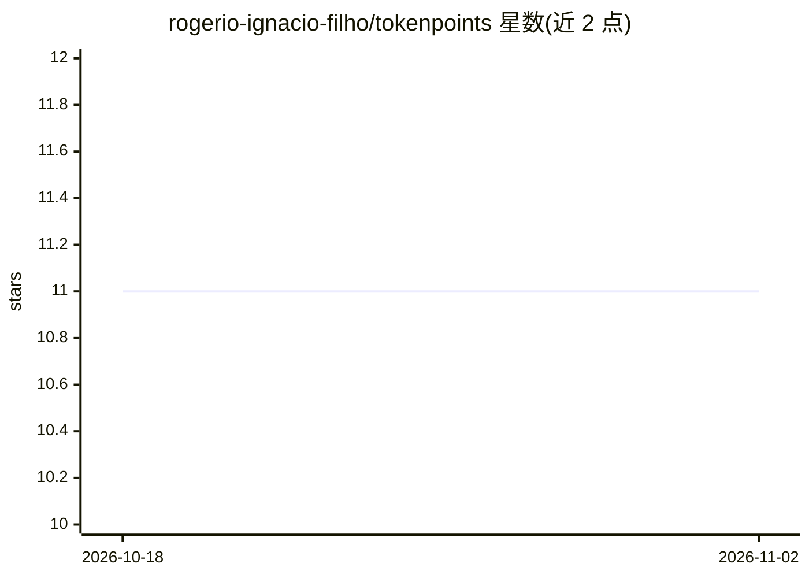

# rogerio-ignacio-filho/tokenpoints

⭐ 11 · HTML · NOASSERTION · 推送 2026-05-03 · [GitHub](https://github.com/rogerio-ignacio-filho/tokenpoints) · [官网](https://rogerio-grocers.github.io/tokenpoints/) · 个人维护

**以 LLM 推理美元成本估算软件工作量的方法论框架**

面向采用 AI 编码代理的软件团队的工作量估算方法论：以任务消耗的 LLM 推理美元成本取代工时或故事点，提供 XS→XL 六级规模尺度（锚定 USD 区间，如 XS<$1、XL $160–$400）、校准手册、追踪模板、Scrum/Kanban 集成指南与反模式清单，另附 6 条原则的宣言文档。以 Markdown 文档仓库形式提供（CC BY 4.0），README 自述为 v0.1 早期草稿，数值范围待社区数据校准。

## 筛选速览

| 维度 | 判定 | 备注 |
|---|---|---|
| AI 角色 | `ai-knowledge` | 知识聚合/清单类 |
| 许可风险 | `none` | NOASSERTION |
| 部署形态 | `None` |  |
| 模型依赖 | — | README 未给出锁定关系 |
| 硬件要求 | — | 无带数字的原话,不猜 |
| 安装摩擦 | `low` | 无编译、无系统依赖或容器化 |
| 成熟度 | `idea` | |

## 能力要点

- XS→XL 六级尺度，以美元成本区间而非时间锚定
- 两冲刺内将通用尺度校准为团队自身数字的手册
- 提供 Scrum/Kanban 集成指南与追踪模板
- 超过 XL 的任务必须分解，否则先做 spike 调研

## 适用场景

- AI 代理写代码为主的团队用美元成本做任务估算
- 在现有 Scrum/Kanban 流程中替换故事点
- 用模板收集数据后校准本团队的估算基线

## 场景标签

 · 领域:软件工程/项目管理方法论

## 证据(README 行号)

> L12: A framework for estimating software work in **dollars of LLM inference**, not hours or story points.
> L28: - **A 6-pillar manifesto** — why dollars beat points, and where the limits are.

## 星数曲线

2026-10-18 11 → 2026-11-02 11（+0）

---
*卡片 v1 · prompt 1.4 · 生成 2026-11-01 · 置信度 high · 依据 README sha `0f72266b13b0` · [字段定义](../../DATASET.md)*
