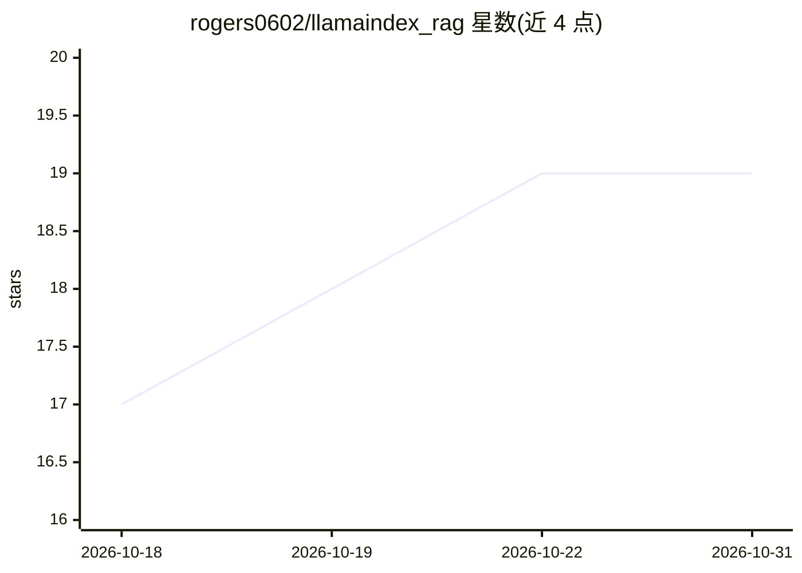

# rogers0602/llamaindex_rag

⭐ 19 · Python · 推送 2025-12-08 · [GitHub](https://github.com/rogers0602/llamaindex_rag) · 个人维护 · 中文 README

**企业私有化 RAG 知识库后端：离线部署、RBAC 与 LDAP 认证**

基于 LlamaIndex 与 FastAPI 构建的企业级 RAG 知识库后端：LLM（qwen2.5）与 Embedding（bge-m3）由 Ollama 服务统一运行，内置 BGE-Reranker 本地重排模型，检索结果支持 PDF 原文级溯源高亮。面向数据安全敏感型企业，支持完全离线部署、LDAP/AD 双模认证、基于 Workspace 的部门级多租户隔离，数据存储于本地 PostgreSQL（pgvector），提供 Docker Compose 一键部署。限制：AGPL-3.0 许可，闭源商用需购买商业授权；扫描件 PDF 解析与混合检索仍在开发计划中。

## 筛选速览

| 维度 | 判定 | 备注 |
|---|---|---|
| AI 角色 | `ai-native` | 本体是模型或模型工具 |
| 许可风险 | `none` | — |
| 部署形态 | `self-host` | docker 或自建部署 |
| 模型依赖 | local-ok | 支持本地模型 |
| 硬件要求 | — | 无带数字的原话,不猜 |
| 安装摩擦 | `low` | 无编译、无系统依赖或容器化 |
| 成熟度 | — | 结构信号不足 |

## 能力要点

- Ollama 统一运行 LLM 与 Embedding，镜像内置 Reranker 模型，支持断网部署
- RBAC 权限与 Workspace 部门级多租户隔离
- 本地账号 + LDAP/AD 双模认证并自动同步组织架构
- 引用溯源返回切片位置，支持 PDF 原文高亮定位

## 适用场景

- 在内网/物理隔离环境搭建企业知识库问答系统
- 按部门隔离文档权限并接入企业域账号登录
- 上传 PDF/Word/Excel 等文档，进行带溯源高亮的问答

## 场景标签

`文档问答` · 领域:知识与检索

## 证据(README 行号)

> L9: 基于 **LlamaIndex** 和 **FastAPI** 构建的企业级 RAG（检索增强生成）知识库后端系统。
> L40: 这是一个专为**数据安全敏感型企业**打造的 RAG（检索增强生成）知识库系统。
> L62: * **精准溯源高亮**：不同于普通的“显示引用文件”，本系统实现了**PDF/TXT 原文级高亮定位**。点击引用，弹窗自动滚动并高亮具体的段落，所见即所得。

## 星数曲线

2026-10-18 17 → 2026-10-31 19（+2）

---
*卡片 v1 · prompt 1.4 · 生成 2026-10-28 · 置信度 mid · 依据 README sha `a02da14383c1` · [字段定义](../../DATASET.md)*
