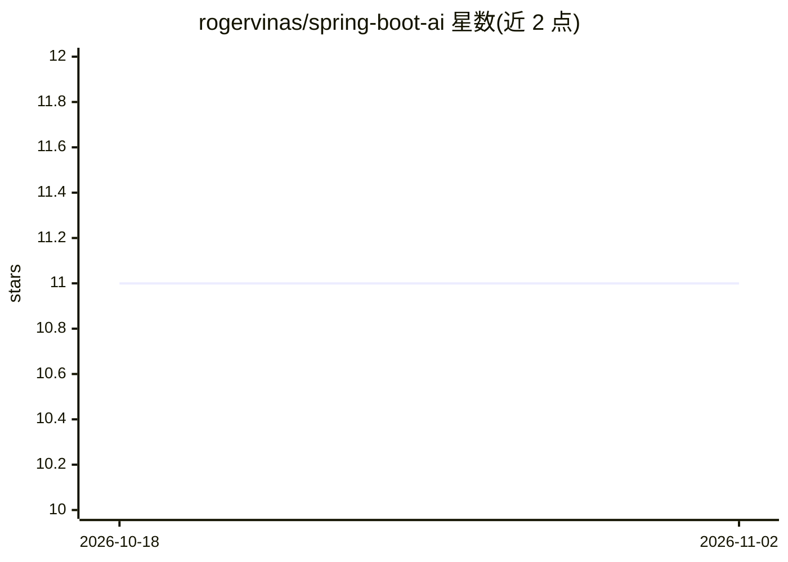

# rogervinas/spring-boot-ai

⭐ 11 · Kotlin · 推送 2026-10-27 · [GitHub](https://github.com/rogervinas/spring-boot-ai) · [官网](https://dev.to/rogervinas/spring-boot-ai-evaluation-testing-2ijk) · 个人维护

**Spring AI 示例工程：MCP+RAG 构建 AI agent 及评估测试**

受 AWS 教程启发的示例项目（PoC）：用 Spring AI 构建帮助用户预订住宿的 AI agent，演示 Chat Client API 与 Advisors、MCP（本地 Weather 工具+远程 Booking MCP 服务器）、基于 PGVector 的 RAG，以及用 AI 模型自评估（self-evaluation）的测试方法（自建 TestEvaluator）。支持 Ollama（本地）/Google Gemini/AWS Bedrock 三种 profile，通过 SPRING_PROFILES_ACTIVE 切换。代码为 Java/Kotlin，Gradle 构建，测试用 Testcontainers 启动 PGVector。README 自述为 PoC，生产环境通常只用单一模型。

## 筛选速览

| 维度 | 判定 | 备注 |
|---|---|---|
| AI 角色 | `ai-ecosystem` | LLM/agent 周边工具 |
| 许可风险 | `none` | — |
| 部署形态 | `self-host` | docker 或自建部署 |
| 模型依赖 | local-ok | 支持本地模型 |
| 硬件要求 | — | 无带数字的原话,不猜 |
| 安装摩擦 | `low` | 无编译、无系统依赖或容器化 |
| 成熟度 | — | 结构信号不足 |

## 能力要点

- 本地 MCP 工具与远程 MCP 服务器（SSE）组合的 agent 工具调用
- Ollama/Gemini/Bedrock 三 profile 切换，同一代码适配不同模型
- RAG（PGVector 向量库）+ 聊天记忆 + 日志三个 Advisor
- 基于 self-evaluation 的 AI 评估测试，含自定义 TestEvaluator

## 适用场景

- 学习如何在 Spring Boot 中组合 MCP、RAG 与多模型配置
- 参考 Spring AI agent 的评估测试写法
- 了解同一代码在本地 Ollama 与云端模型间切换的配置方式

## 场景标签

`RAG` `教程课程` · 领域:知识与检索

## 证据(README 行号)

> L14: In this example, inspired by Building Agents with AWS: Complete Tutorial, we will build a simple AI agent applicati
> L22: The original example uses AWS Bedrock, but one of the great things about **Spring AI** is that with just a few conf
> L277: Now for the interesting part, how do we test the AI agent’s response? This is where Evaluation Testing comes in:

## 星数曲线

2026-10-18 11 → 2026-11-02 11（+0）

---
*卡片 v1 · prompt 1.4 · 生成 2026-11-01 · 置信度 mid · 依据 README sha `1bc2f675b2c6` · [字段定义](../../DATASET.md)*
