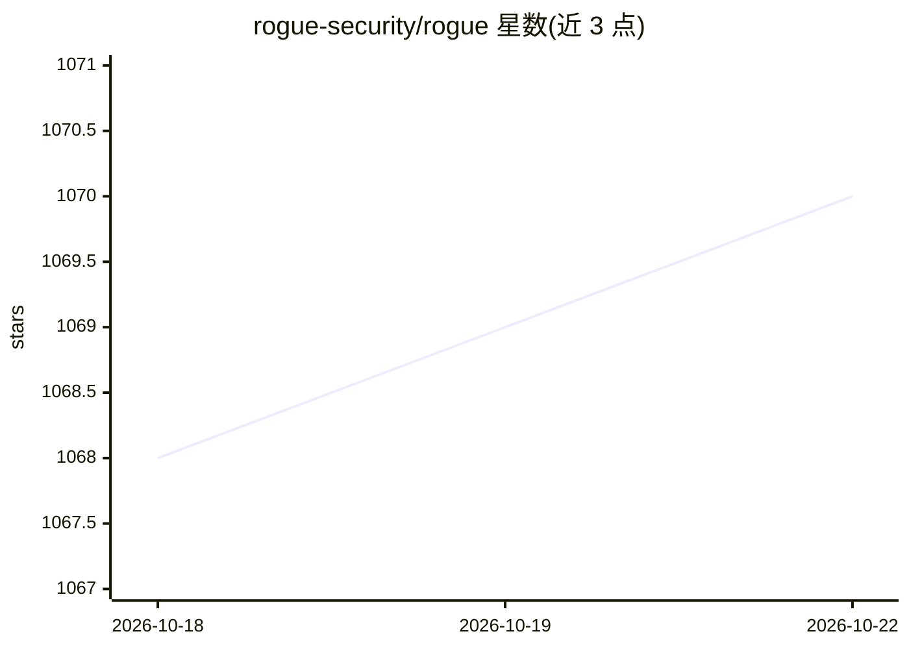

# rogue-security/rogue

⭐ 1,071 · Python · NOASSERTION · 推送 2026-08-04 · [GitHub](https://github.com/rogue-security/rogue) · [官网](https://qualifire.ai) · 组织维护

**AI agent 评测与红队测试平台：安全与合规扫描**

面向 AI agent 的自动化评测与红队测试平台，提供两种模式：基于业务策略的场景评测（回归测试、行为验证）与对抗攻击模拟（75+ 漏洞类型、20 种攻击技术、CVSS 打分、8 个合规框架对照）。架构为客户端-服务器，含 TUI、CLI 界面，通过 A2A、MCP 协议或 Python 函数入口连接被测 agent，由 judge LLM 评判结果。需 Python 3.10+ 与 LLM API key，支持随机种子实现可复现扫描。许可证为专有许可。

## 筛选速览

| 维度 | 判定 | 备注 |
|---|---|---|
| AI 角色 | `ai-ecosystem` | LLM/agent 周边工具 |
| 许可风险 | `none` | NOASSERTION |
| 部署形态 | `None` |  |
| 模型依赖 | — | README 未给出锁定关系 |
| 硬件要求 | — | 无带数字的原话,不猜 |
| 安装摩擦 | `low` | 无编译、无系统依赖或容器化 |
| 成熟度 | — | 结构信号不足 |

## 能力要点

- 红队扫描覆盖 75+ 漏洞、12 个安全类别、20 种攻击技术
- 对照 OWASP/MITRE/NIST/EU AI Act 等 8 个合规框架
- 通过 A2A/MCP/Python 入口连接被测 agent，judge LLM 评判
- 随机种子支持确定性、可复现扫描，适配 CI/CD

## 适用场景

- agent 上线前做安全红队扫描与合规审计
- 基于业务策略对 agent 做回归测试与行为验证
- 在 CI/CD 流水线中非交互运行安全扫描

## 场景标签

`模型评测` `网络安全` · 领域:评测与运维

## 证据(README 行号)

> L1: # Rogue — AI Agent Evaluator & Red Team Platform
> L15: Test your agent against **business policies** and expected behaviors.
> L26: Simulate **adversarial attacks** to find security vulnerabilities.

## 星数曲线

2026-10-18 1,068 → 2026-10-22 1,070（+2）

---
*卡片 v1 · prompt 1.4 · 生成 2026-10-21 · 置信度 high · 依据 README sha `cc1a9ce73340` · [字段定义](../../DATASET.md)*
