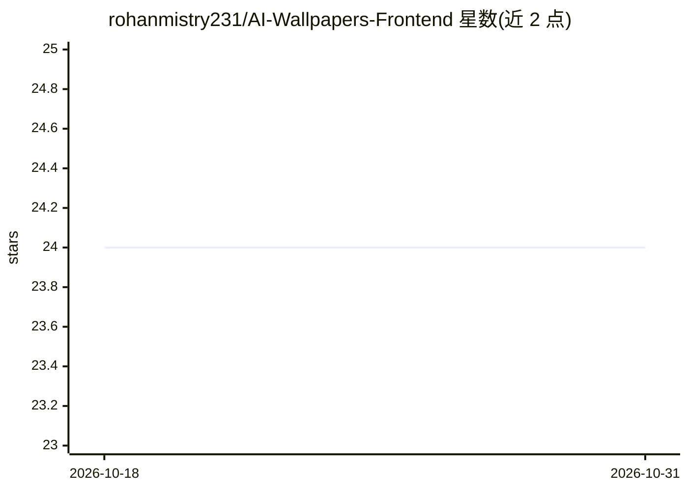

# rohanmistry231/AI-Wallpapers-Frontend

⭐ 24 · JavaScript · MIT · 推送 2026-01-03 · [GitHub](https://github.com/rohanmistry231/AI-Wallpapers-Frontend) · [官网](https://own-walls-ai.netlify.app/) · 个人维护

**AI 壁纸生成平台的前端：浏览/定制/下载 AI 生成壁纸**

基于 Create React App 脚手架的 React 前端项目，用于 AI 壁纸生成平台的界面展示。README 仅有脚手架默认内容：说明 npm start/test/build/eject 四个脚本的用途与行为，指向 Create React App 与 React 官方文档的扩展章节链接。仓库描述称使用 TypeScript 与 Tailwind CSS，需配合 Node.js 后端提供动态内容，但这些信息不在 README 正文中，无法从可见内容验证具体功能实现。

## 筛选速览

| 维度 | 判定 | 备注 |
|---|---|---|
| AI 角色 | `ai-ecosystem` | LLM/agent 周边工具 |
| 许可风险 | `permissive` | MIT |
| 部署形态 | `None` |  |
| 模型依赖 | — | README 未给出锁定关系 |
| 硬件要求 | — | 无带数字的原话,不猜 |
| 安装摩擦 | `low` | 无编译、无系统依赖或容器化 |
| 成熟度 | — | 结构信号不足 |

## 能力要点

- React 前端，提供开发/测试/构建脚本
- README 指向 Create React App 官方文档各章节
- 按仓库描述需配合 Node.js 后端使用

## 适用场景

- 作为 AI 壁纸平台的 Web 界面运行开发服务器
- 构建生产版本部署前端页面

## 场景标签

`图像生成` · 领域:内容生成

## 证据(README 行号)

> L1: # Getting Started with Create React App
> L3: This project was bootstrapped with Create React App.

## 星数曲线

2026-10-18 24 → 2026-10-31 24（+0）

---
*卡片 v1 · prompt 1.4 · 生成 2026-10-27 · 置信度 low · 依据 README sha `2544ee43f848` · [字段定义](../../DATASET.md)*
