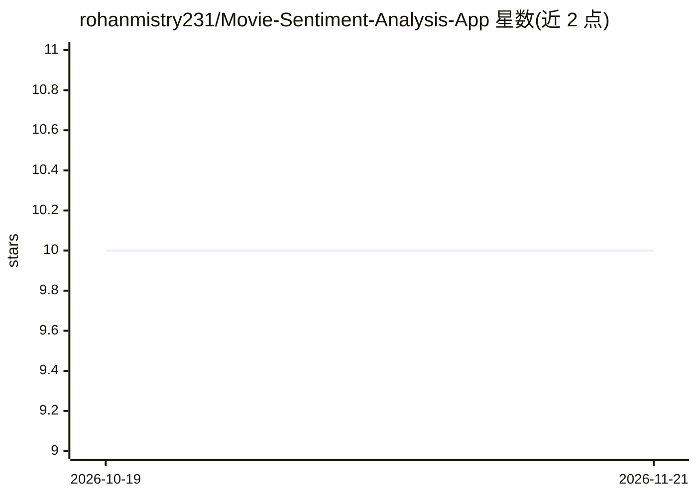

# rohanmistry231/Movie-Sentiment-Analysis-App

⭐ 10 · Jupyter Notebook · MIT · 推送 2026-07-31 · [GitHub](https://github.com/rohanmistry231/Movie-Sentiment-Analysis-App) · 个人维护

**基于 LSTM 的影评情感分析 Web 应用**

用 Streamlit 与 TensorFlow 构建的影评情感分类应用：加载在 IMDB 数据集（50,000 条影评）上训练的 LSTM 模型（model.h5 与 tokenizer.pkl），对输入文本给出 Positive/Negative 预测及置信度分数。提供示例影评、Markdown 格式的历史记录下载、CSV 批量分析（最多 50 行、5 MiB 以内，按列名优先级取文本列）。模型文件需通过附带的 Jupyter Notebook 自行训练生成，或使用已有的预训练文件；支持本地运行与部署到 Streamlit Cloud。

## 筛选速览

| 维度 | 判定 | 备注 |
|---|---|---|
| AI 角色 | `ai-native` | 本体是模型或模型工具 |
| 许可风险 | `permissive` | MIT |
| 部署形态 | `library` | 以包/库形式分发 |
| 模型依赖 | — | README 未给出锁定关系 |
| 硬件要求 | — | 无带数字的原话,不猜 |
| 安装摩擦 | `low` | 无编译、无系统依赖或容器化 |
| 成熟度 | — | 结构信号不足 |

## 能力要点

- IMDB 数据集训练的 LSTM 模型，输出情感标签与置信度
- 预加载示例影评与历史记录导出为 Markdown
- 支持上传 CSV 批量分析，按列名优先级自动识别文本列
- 提供完整训练 notebook（数据下载、预处理、训练、保存）

## 适用场景

- 输入影评文本快速获取正负面情感判断
- 上传 CSV 导出结果做批量情感分析
- 按 notebook 复现 LSTM 情感模型的训练流程

## 场景标签

 · 领域:自然语言处理/文本情感分析

## 证据(README 行号)

> L8: Welcome to **Movie Review Sentiment Analysis**, a web application that predicts the sentiment (positive or negative)
> L12: - **Sentiment Prediction**: Analyze any movie review and get instant sentiment predictions (Positive/Negative) with
> L156: - **Model Architecture**: LSTM with an Embedding layer, trained using TensorFlow.

## 星数曲线

2026-10-19 10 → 2026-11-21 10（+0）

---
*卡片 v1 · prompt 1.4 · 生成 2026-11-19 · 置信度 high · 依据 README sha `0ccf5ab26619` · [字段定义](../../DATASET.md)*
