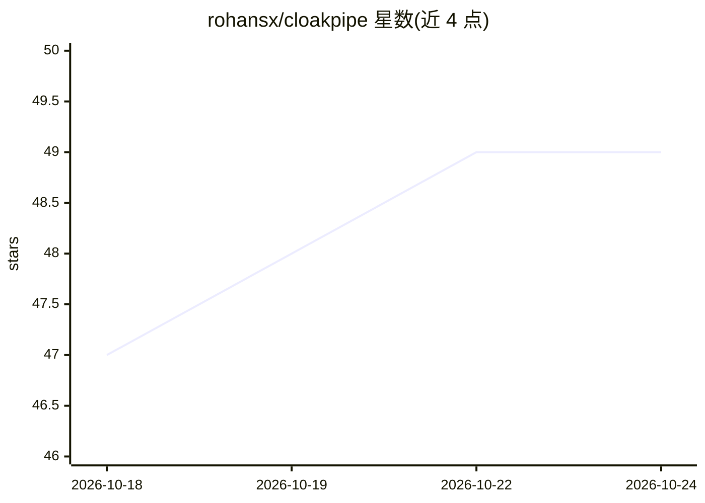

# rohansx/cloakpipe

⭐ 49 · Rust · MIT · 推送 2026-10-23 · [GitHub](https://github.com/rohansx/cloakpipe) · [官网](https://cloakpipe.co) · 个人维护

**面向生产 AI agent 的可验证控制平面：评测、认证、执行与取证**

开源 Rust 工具包（Cargo workspace，约 16 个 crate），围绕 Evaluate→Certify→Enforce→Prove 四环节运作：将 JUnit XML、Braintrust、Langfuse 评测结果绑定到 release 哈希，用确定性策略引擎生成 Ed25519 签名的 in-toto 认证；运行时提供 OpenAI/Anthropic 兼容的隐私代理（PII 检测、token 置换、AES-256-GCM 加密 vault）、MCP 工具门控（仅放行认证 release 声明的工具、参数契约校验、签批回执、副作用操作追踪），所有决策记入可外部锚定（RFC 3161、Sigstore Rekor）且离线可验证的无 PII 证据账本。通过 cargo install 或 Docker 镜像安装；agent-release 相关命令尚未进入 tagged release，本地模式为未实现的占位 crate。

## 筛选速览

| 维度 | 判定 | 备注 |
|---|---|---|
| AI 角色 | `ai-ecosystem` | LLM/agent 周边工具 |
| 许可风险 | `permissive` | MIT |
| 部署形态 | `self-host` | docker 或自建部署 |
| 模型依赖 | — | README 未给出锁定关系 |
| 硬件要求 | — | 无带数字的原话,不猜 |
| 安装摩擦 | `low` | 无编译、无系统依赖或容器化 |
| 成熟度 | `idea` | |

## 能力要点

- release manifest 以 RFC 8785 规范哈希钉住代码/提示词/模型/工具等全部行为组件
- PII 隐私代理支持流式响应的置换与还原，附带 AES-256-GCM 加密 vault
- MCP 工具门控：工具契约、签批回执、副作用操作去重与对账
- 哈希链签名证据账本可锚定 RFC 3161 TSA / Sigstore Rekor 并离线验证

## 适用场景

- 生产环境 agent 发布前做评测导入与签名认证，CI 中阻断不合格 release
- 防止模型提供商接触 PII，同时保持多轮会话一致性
- 限制 agent 只能调用认证 release 声明的 MCP 工具并留存审计证据
- 向审计方交付单一签名审计包并离线验证

## 场景标签

`模型评测` `模型网关` · 领域:Agent 开发

## 证据(README 行号)

> L30: - At runtime, a **privacy proxy** keeps PII away from model providers and an
> L31:  **MCP tool gate** refuses tool calls that the certified release does not allow.
> L42: |**Evaluate**|Import evaluation results as native, release-bound `EvaluationRun`s: **JUnit XML** (pytest, Jest, Go,

## 星数曲线

2026-10-18 47 → 2026-10-24 49（+2）

---
*卡片 v1 · prompt 1.4 · 生成 2026-10-24 · 置信度 mid · 依据 README sha `c87fa38ad087` · [字段定义](../../DATASET.md)*
