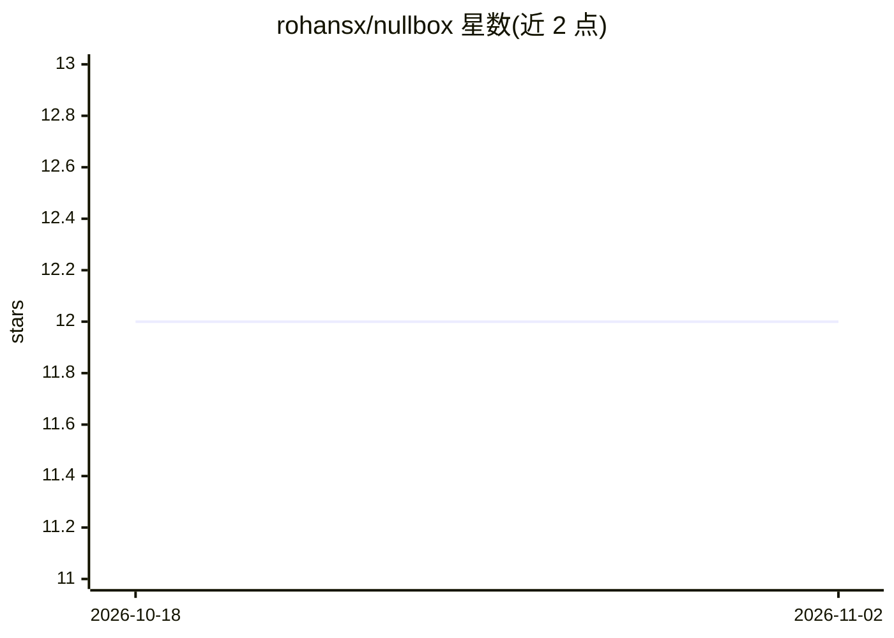

# rohansx/nullbox

⭐ 12 · Rust · 推送 2026-04-05 · [GitHub](https://github.com/rohansx/nullbox) · [官网](https://nullbox.sh) · 个人维护

**专用于运行自主 AI agent 的不可变极简 Linux 发行版**

面向安全运行自主 AI agent 的场景，提供硬化 Linux 发行版：只读 SquashFS 根文件系统、无 SSH/shell/systemd/包管理器，每个 agent 在独立 libkrun microVM 中运行并受 CPU/内存上限约束。网络默认拒绝，agent 在 AGENT.toml 中声明允许域名；秘密经 AES-256-GCM 加密存储（warden）；ctxgraph 提供基于 SQLite 的内容寻址共享内存。内核为自编译 Linux 6.18（禁用模块与 io_uring，Clang CFI、Seccomp/Landlock/AppArmor）。需自行从源码构建 ISO（Rust nightly + Clang/LLVM 等），可刷 USB 或在 QEMU 中启动，系统仅含六个二进制。

## 筛选速览

| 维度 | 判定 | 备注 |
|---|---|---|
| AI 角色 | `ai-ecosystem` | LLM/agent 周边工具 |
| 许可风险 | `none` | — |
| 部署形态 | `None` |  |
| 模型依赖 | — | README 未给出锁定关系 |
| 硬件要求 | — | 无带数字的原话,不猜 |
| 安装摩擦 | `low` | 无编译、无系统依赖或容器化 |
| 成熟度 | — | 结构信号不足 |

## 能力要点

- 每个 agent 运行于独立 libkrun microVM，受资源上限约束
- 默认拒绝网络，agent 在 AGENT.toml 声明允许域名
- AES-256-GCM 加密 vault（PBKDF2 派生密钥）管理秘密
- 只读 SquashFS 根文件系统，仅含六个系统二进制

## 适用场景

- 在隔离 microVM 中安全运行自主 AI agent
- 对 agent 的网络出站按域名白名单严格控制
- 让多个 agent 通过内容寻址内存共享上下文而不互相可见

## 场景标签

 · 领域:操作系统/AI agent 基础设施

## 证据(README 行号)

> L9: NullBox is a hardened Linux distribution where the entire OS exists to run autonomous AI agents — and nothing else. 
> L25: |**cage**|Spawns per-agent microVMs via libkrun (KVM), enforces CPU/memory caps, injects secrets as env vars|

## 星数曲线

2026-10-18 12 → 2026-11-02 12（+0）

---
*卡片 v1 · prompt 1.4 · 生成 2026-11-01 · 置信度 high · 依据 README sha `a6ce46d88d00` · [字段定义](../../DATASET.md)*
