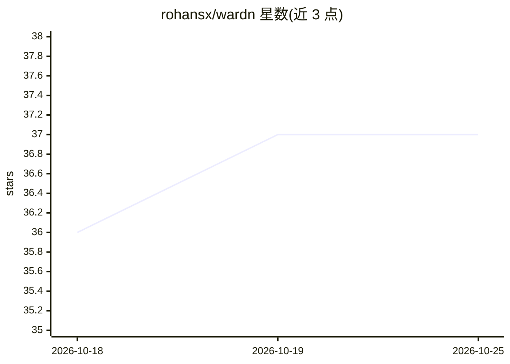

# rohansx/wardn

⭐ 37 · Rust · MIT · 推送 2026-09-30 · [GitHub](https://github.com/rohansx/wardn) · 个人维护

**面向 AI agent 的凭证防火墙：代理注入真实密钥，agent 只见占位符**

Rust 编写的本地凭证隔离工具：真实 API 密钥存于 AES-256-GCM 加密金库（Argon2id 派生密钥），agent 进程只接收无用的占位符 token；本地 HTTP 代理在唯一网络缝隙处将占位符换为真实密钥转发上游，并在响应返回前剥离真实密钥。支持 MCP 服务器集成 Claude Code 与 Cursor，提供凭证迁移、dotenv 导入、速率限制、预算控制与只读本地仪表盘。当前自托管层不防御主机 root 被攻破，机密计算托管层为规划中。

## 筛选速览

| 维度 | 判定 | 备注 |
|---|---|---|
| AI 角色 | `ai-ecosystem` | LLM/agent 周边工具 |
| 许可风险 | `permissive` | MIT |
| 部署形态 | `library` | 以包/库形式分发 |
| 模型依赖 | — | README 未给出锁定关系 |
| 硬件要求 | — | 无带数字的原话,不猜 |
| 安装摩擦 | `low` | 无编译、无系统依赖或容器化 |
| 成熟度 | — | 结构信号不足 |

## 能力要点

- 占位符 token 机制：真实密钥不进入 agent 内存/日志/LLM 上下文
- AES-256-GCM + Argon2id 加密金库，敏感字符串 drop 时清零
- MCP 服务器集成 Claude Code / Cursor，三条只读 MCP 工具
- 每凭证每 agent 速率限制与预算控制，本地只读仪表盘

## 适用场景

- 防止被入侵的 agent 或恶意技能窃取 API 密钥
- 让 Claude Code / Cursor 等编程 agent 不接触真实凭证
- 限制 agent 的 API 花费，防止循环调用导致成本失控
- 扫描并迁移 .env 等暴露的存量密钥到加密金库

## 场景标签

`网络安全` · 领域:学习与行业

## 证据(README 行号)

> L3: **A credential firewall for AI agents.**
> L49: wardn hands agents a useless placeholder string and removes the real key
> L50: from every surface it can reach. Real keys are injected at the network
> L51: layer — a single seam — and stripped from responses before they reach

## 星数曲线

2026-10-18 36 → 2026-10-25 37（+1）

---
*卡片 v1 · prompt 1.4 · 生成 2026-10-25 · 置信度 high · 依据 README sha `c259f49be924` · [字段定义](../../DATASET.md)*
