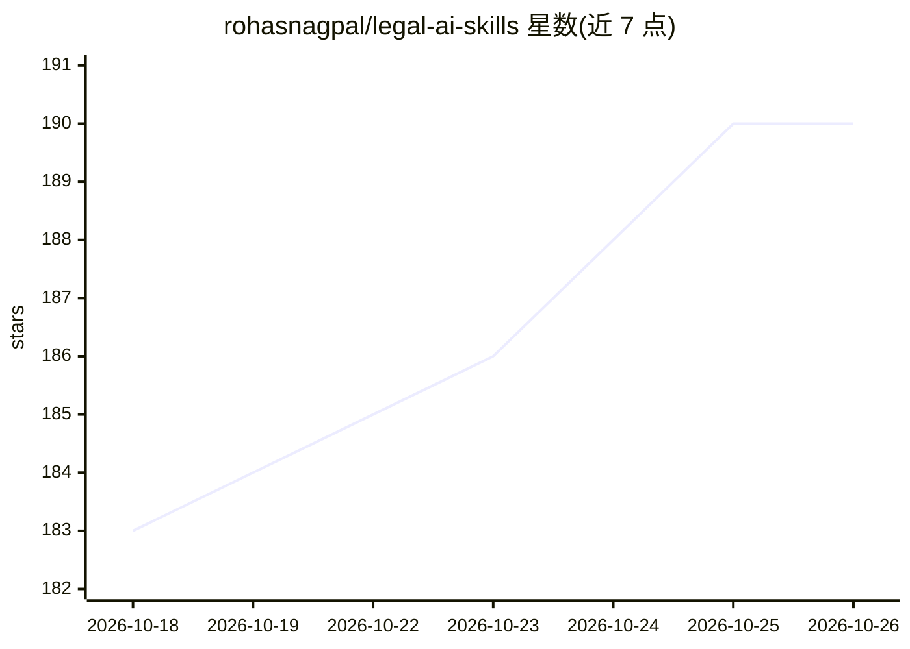

# rohasnagpal/legal-ai-skills

⭐ 190 · JavaScript · MIT · 推送 2026-10-10 · [GitHub](https://github.com/rohasnagpal/legal-ai-skills) · 个人维护 · 中文 README

**面向 Claude Code/Codex 的律所 AI 技能包：17 名律师+226 项法律技能**

以插件形式安装到 Claude Code 或 Codex 的法律 AI 技能包：提供 1 个 Managing Partner、17 名专科律师角色、3 名辖区顾问（印度/美国/英国）、226 项可复用法律技能与 20 个流程（并购尽调、离婚诉讼、合同谈判等），并内置 14 个官方法律研究源连接器（CourtListener、SEC EDGAR 等）、本地制裁名单筛查与本地截止日期/利息计算器。使用费用为 0 美元加用户的 ChatGPT 或 Claude 订阅；不保证输出准确完整，需人工法律复核。

## 筛选速览

| 维度 | 判定 | 备注 |
|---|---|---|
| AI 角色 | `ai-ecosystem` | LLM/agent 周边工具 |
| 许可风险 | `permissive` | MIT |
| 部署形态 | `None` |  |
| 模型依赖 | — | README 未给出锁定关系 |
| 硬件要求 | — | 无带数字的原话,不猜 |
| 安装摩擦 | `low` | 无编译、无系统依赖或容器化 |
| 成熟度 | — | 结构信号不足 |

## 能力要点

- 17 名专科律师+3 名辖区顾问（印度/美国/英国）+226 项法律技能+20 个流程
- 14 个官方法律研究源连接器（法院记录、法规、公司注册、制裁名单）
- 制裁名单筛查与截止日期/利息计算器均在本地机器运行
- 支持 'Should I Sue' 争议可行性评估模式，只读取用户打开的文件夹

## 适用场景

- 律师/法务用 AI 律师团队处理合同审查、尽调、诉讼准备等事务
-  startups 与企业起草创始人协议、NDA、评估隐私法适用
- 通过 'Should I Sue' 模式评估是否值得起诉、仲裁或调解
- 本地筛查美英 UN 制裁名单与计算法律期限

## 场景标签

`科研工具` · 领域:学习与行业

## 证据(README 行号)

> L3: To install **Legal AI Skills by Rohas Nagpal**, open **Claude Code** or the **Codex** app or CLI on your computer an
> L77: - **Claude Code:** run `claude plugin marketplace add rohasnagpal/legal-ai-skills`, then `claude plugin install leg
> L180: **Where does it run?** Inside Codex or Claude. In Claude Code each lawyer runs as its own subagent. In Codex, lawy

## 星数曲线

2026-10-18 183 → 2026-10-26 190（+7）

---
*卡片 v1 · prompt 1.4 · 生成 2026-10-22 · 置信度 high · 依据 README sha `09f7a86d55c8` · [字段定义](../../DATASET.md)*
