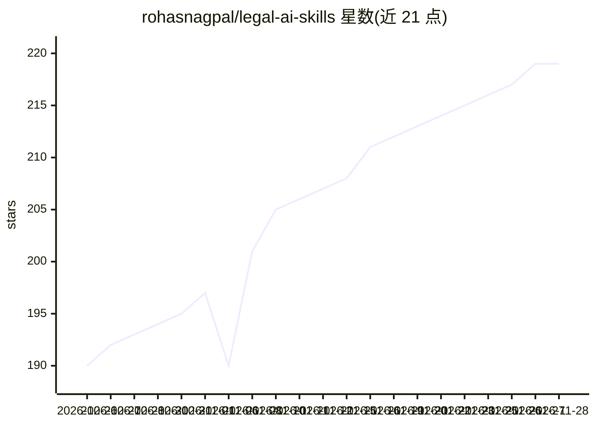

# rohasnagpal/legal-ai-skills

⭐ 219 · JavaScript · MIT · 推送 2026-11-24 · [GitHub](https://github.com/rohasnagpal/legal-ai-skills) · 个人维护

**在 Claude Code/Codex 中搭建多角色 AI 法律事务所的技能插件**

以 Claude Code / Codex 插件形式分发的法律技能集合：安装后通过提示词激活一个由管理合伙人、17 名专长律师、15 个辖区顾问组成的 AI 律师团队，覆盖 452 个法律技能（合同审查、尽调、起草等）与 24 个工作流，支持 15 个辖区的法律检索与来源指引，附带截止期/利息计算器和本地制裁名单筛查。安装依赖 Claude Code 或 Codex CLI（网页版不支持）；README 明确输出须经合格法律专业人员审查，实际模型表现未经评估。

## 筛选速览

| 维度 | 判定 | 备注 |
|---|---|---|
| AI 角色 | `ai-native` | 本体是模型或模型工具 |
| 许可风险 | `permissive` | MIT |
| 部署形态 | `None` |  |
| 模型依赖 | — | README 未给出锁定关系 |
| 硬件要求 | — | 无带数字的原话,不猜 |
| 安装摩擦 | `low` | 无编译、无系统依赖或容器化 |
| 成熟度 | — | 结构信号不足 |

## 能力要点

- 452 个法律技能 + 24 个工作流 + 17 名专长律师的多角色分工架构
- 覆盖 15 个辖区的辖区顾问，提供本地法律路由与官方来源指引
- 内置截止期与利息计算器、美/英/UN 制裁名单本地筛查
- 支持事务保存/恢复与文档变更后重新评估

## 适用场景

- 把合同、邮件、截图放入文件夹，让 AI 律师团队评估是否起诉
- 为跨境扩张生成有来源引用的合规矩阵与优先级计划
- 识别业务可能适用的法律法规并链接官方来源
- 新设公司时比较组织结构并生成设立路线图

## 场景标签

 · 领域:法律/法律科技

## 证据(README 行号)

> L3: To install **Legal AI Skills by Rohas Nagpal**, open **Claude Code** or the **Codex** app or CLI on your computer an
> L20: - **452 Legal Skills:** Reusable capabilities such as contract review, legal research, due diligence, evidence anal
> L64: Put your contracts, emails, messages, screenshots and notices in one folder, open a new session in that folder, and

## 星数曲线

2026-10-26 190 → 2026-11-28 219（+29）

---
*卡片 v1 · prompt 1.4 · 生成 2026-11-26 · 置信度 high · 依据 README sha `2bf26e4f7417` · [字段定义](../../DATASET.md)*
