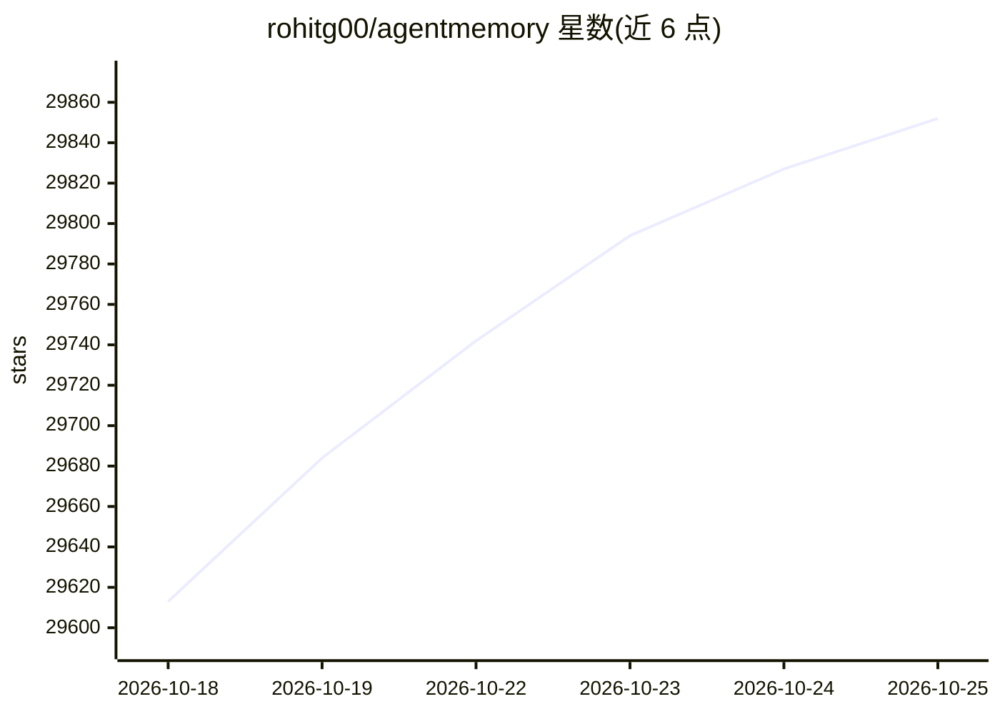

# rohitg00/agentmemory

⭐ 29,883 · TypeScript · Apache-2.0 · 推送 2026-10-25 · [GitHub](https://github.com/rohitg00/agentmemory) · [官网](https://agent-memory.dev) · 个人维护

**给 AI 编码 agent 提供跨会话持久记忆的 MCP 服务器**

基于 iii 引擎的记忆服务：通过 12 个自动 hook 捕获 agent 会话，压缩为可检索记忆，下次会话时注入相关上下文；支持 BM25、本地向量嵌入（Xenova/all-MiniLM-L6-v2）与图结构匹配的混合检索（RRF 融合），提供 54 个 MCP 工具与 REST API。兼容支持 hooks、MCP 或 REST 的任意 agent，官方列出 20 余个适配器。无外部数据库依赖（SQLite + 内置 iii 引擎）。可配置 LLM provider 实现 LLM 压缩，也可完全 keyless 运行。

## 筛选速览

| 维度 | 判定 | 备注 |
|---|---|---|
| AI 角色 | `ai-native` | 本体是模型或模型工具 |
| 许可风险 | `permissive` | Apache-2.0 |
| 部署形态 | `desktop` | 安装包/桌面程序 |
| 模型依赖 | — | README 未给出锁定关系 |
| 硬件要求 | — | 无带数字的原话,不猜 |
| 安装摩擦 | `low` | 无编译、无系统依赖或容器化 |
| 成熟度 | — | 结构信号不足 |

## 动量与使用信号

- 维护:`active` — 距上次 push 1.8 天,年发版 52,50 位贡献者
- 涨星:近 1 天 **+52**(自 20261016 起算)
- 安装:npm 包 `@agentmemory/agentmemory` 月下载 35,160
- 平台:WINDOWS / MACOS / LINUX · 协议:OPENAI-API / MCP / OLLAMA

## 能力要点

- 54 个 MCP 工具 + 12 个自动 hook，静默捕获会话并注入上下文
- BM25 + 本地向量 + 图匹配的混合检索，keyless 模式默认可用
- 20+ agent 适配器（Claude Code、Codex CLI、Cursor 等），共享同一记忆服务器
- 无外部数据库依赖，状态存于本地 SQLite + iii 引擎

## 适用场景

- 避免每次会话向编码 agent 重复解释项目架构与偏好
- 多个编码工具（如 Claude Code 与 Cursor）间共享同一份项目记忆
- 本地离线运行语义记忆检索（本地嵌入模型，无 API key）

## 场景标签

`Agent 记忆` · 领域:Agent 开发

## 证据(README 行号)

> L6:  Persistent memory for Claude Code, GitHub Copilot CLI, Cursor, Gemini CLI, Codex CLI, Hermes, OpenClaw, pi, OpenCod
> L132: agentmemory works with any agent that supports hooks, MCP, or REST API. All agents share the same memory server.
> L236: You explain the same architecture every session. You re-discover the same bugs. You re-teach the same preferences.

## 星数曲线

2026-10-18 29,613 → 2026-10-25 29,852（+239）

---
*卡片 v1 · prompt 1.4 · 生成 2026-10-18 · 置信度 mid · 依据 README sha `d654d9ae4f66` · [字段定义](../../DATASET.md)*
