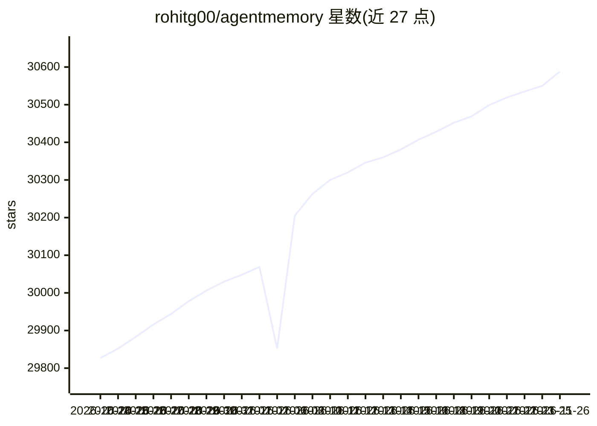

# rohitg00/agentmemory

⭐ 30,588 · TypeScript · Apache-2.0 · 推送 2026-11-18 · [GitHub](https://github.com/rohitg00/agentmemory) · [官网](https://www.agent-memory.dev/docs) · 个人维护

**为 AI 编码 agent 提供跨会话持久记忆的本地服务器**

AgentMemory 是一个为编码 agent 提供持久记忆的本地服务器：通过 hooks、MCP 和 REST API 捕获各 agent 的编码会话，将决策与修复写入四层记忆并建立索引，后续会话通过混合搜索（无 API key 时用 BM25 关键词检索，可选本地/远程嵌入做语义检索）按 token 预算召回。支持 20+ 编码 agent 共享同一记忆库，提供 Web viewer 浏览/编辑/导出记忆，默认全部本地运行、无外部数据库，经 npx/npm 安装，要求 Node.js 20+。

## 筛选速览

| 维度 | 判定 | 备注 |
|---|---|---|
| AI 角色 | `ai-ecosystem` | LLM/agent 周边工具 |
| 许可风险 | `permissive` | Apache-2.0 |
| 部署形态 | `desktop` | 安装包/桌面程序 |
| 模型依赖 | — | README 未给出锁定关系 |
| 硬件要求 | — | 无带数字的原话,不猜 |
| 安装摩擦 | `low` | 无编译、无系统依赖或容器化 |
| 成熟度 | `idea` | |

## 动量与使用信号

- 维护:`active` — 距上次 push 1.8 天,年发版 52,50 位贡献者
- 涨星:近 1 天 **+52**(自 20261016 起算)
- 安装:npm 包 `@agentmemory/agentmemory` 月下载 35,160
- 平台:WINDOWS / MACOS / LINUX · 协议:OPENAI-API / MCP / OLLAMA

## 能力要点

- 54 个 MCP 工具、12 个自动 hooks，零外部数据库
- 无 API key 的 BM25 关键词召回；EMBEDDING_PROVIDER=local 启用本地语义检索
- 一个本地服务器供多个 agent 共享记忆（hooks/MCP/REST 三种接入方式）
- 本地 live viewer 浏览、编辑、导出与遗忘记忆

## 适用场景

- 让 Claude Code/Cursor 等编码 agent 在新会话中召回历史决策与修复
- 多个编码工具之间共享同一份项目记忆
- 离线/无 API key 环境下对 agent 会话做可检索存档

## 场景标签

`Agent 记忆` · 领域:Agent 开发

## 证据(README 行号)

> L5:  Persistent memory for Claude Code, GitHub Copilot CLI, Cursor, Gemini CLI, Codex CLI, Hermes, OpenClaw, pi, Oh My P
> L74: AgentMemory captures coding sessions, makes decisions and fixes searchable, and lets your agents recall them later.
> L130: agentmemory works with any agent that supports hooks, MCP, or REST API. All agents share the same memory server.

## 星数曲线

2026-10-24 29,827 → 2026-11-26 30,588（+761）

---
*卡片 v1 · prompt 1.4 · 生成 2026-11-22 · 置信度 mid · 依据 README sha `58941457ec74` · [字段定义](../../DATASET.md)*
