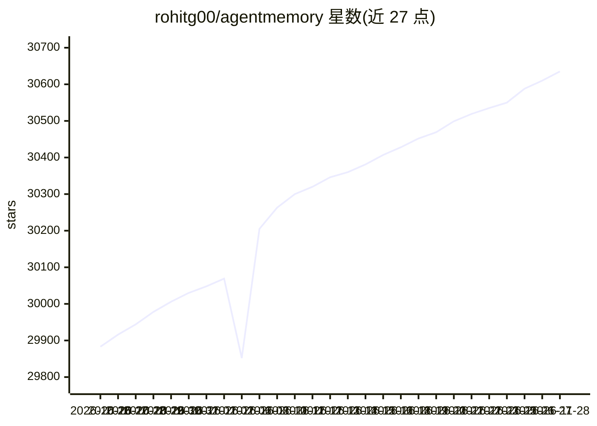

# rohitg00/agentmemory

⭐ 30,635 · TypeScript · Apache-2.0 · 推送 2026-11-27 · [GitHub](https://github.com/rohitg00/agentmemory) · [官网](https://www.agent-memory.dev/docs) · 个人维护

**为 AI 编码代理提供跨会话持久记忆的本地服务**

AgentMemory 通过本地服务器为 Claude Code、Codex CLI、Copilot CLI、Cursor、Gemini CLI 等 20 余个编码代理提供统一记忆存储：hooks 与插件自动捕获会话事件，写入前做密钥脱敏；检索默认用 BM25 关键词搜索，无需 API key，可配置本地或远程嵌入实现语义搜索与混合检索。提供 54 个 MCP 工具、REST API、实时查看器与记忆导入导出。安装依赖 Node.js 20+，可选压缩功能需配置 provider 并显式开启。

## 筛选速览

| 维度 | 判定 | 备注 |
|---|---|---|
| AI 角色 | `ai-ecosystem` | LLM/agent 周边工具 |
| 许可风险 | `permissive` | Apache-2.0 |
| 部署形态 | `desktop` | 安装包/桌面程序 |
| 模型依赖 | — | README 未给出锁定关系 |
| 硬件要求 | — | 无带数字的原话,不猜 |
| 安装摩擦 | `low` | 无编译、无系统依赖或容器化 |
| 成熟度 | — | 结构信号不足 |

## 动量与使用信号

- 维护:`active` — 距上次 push 1.8 天,年发版 52,50 位贡献者
- 涨星:近 1 天 **+52**(自 20261016 起算)
- 安装:npm 包 `@agentmemory/agentmemory` 月下载 35,160
- 平台:WINDOWS / MACOS / LINUX · 协议:OPENAI-API / MCP / OLLAMA

## 能力要点

- 一个本地服务器，多个代理共享同一记忆库（hooks/MCP/REST 接入）
- 无 key 默认模式用 BM25 检索，可切换本地嵌入做语义搜索
- 自动捕获与回放：12 个 hooks、密钥脱敏、离线 replay
- 实时查看器支持浏览、编辑、导出与删除记忆

## 适用场景

- 跨会话保留项目决策与修复记录供代理回忆
- 在多个编码工具之间共享同一份项目记忆
- 本地查看与审计代理保存了哪些记忆

## 场景标签

`Agent 记忆` · 领域:Agent 开发

## 证据(README 行号)

> L74: AgentMemory captures coding sessions, makes decisions and fixes searchable, and lets your agents recall them later.
> L130: agentmemory works with any agent that supports hooks, MCP, or REST API. All agents share the same memory server.
> L239: One local server sits between your agents and your memory. Each lane runs locally by default; the dashed line mark

## 星数曲线

2026-10-26 29,883 → 2026-11-28 30,635（+752）

---
*卡片 v1 · prompt 1.4 · 生成 2026-11-28 · 置信度 mid · 依据 README sha `83519cd44190` · [字段定义](../../DATASET.md)*
