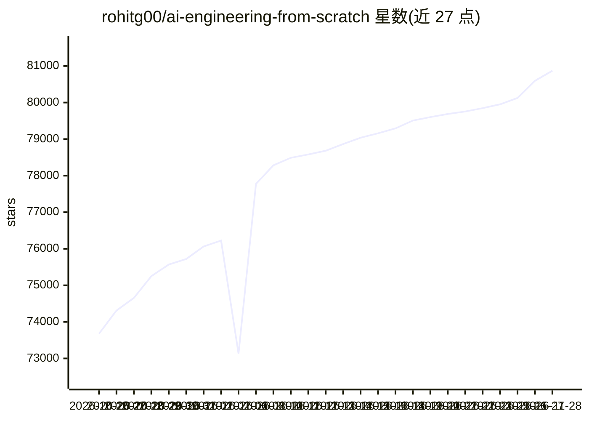

# rohitg00/ai-engineering-from-scratch

⭐ 80,870 · Python · MIT · 推送 2026-11-27 · [GitHub](https://github.com/rohitg00/ai-engineering-from-scratch) · [官网](https://aiengineeringfromscratch.com) · 个人维护

**面向开发者的 AI Engineering 从零构建课程（542 课）**

开源课程仓库，覆盖模型内部实现、检索管道与 agent 运行时的从零实现，共 542 课、20 个阶段，使用 Python/TypeScript/Rust/Julia/Go。学习方式有三种：网站阅读、通过 npx skills 将编码 agent 变为导师（提供 start-learning、learn、course-guide 等 skills，支持 Codex 与 Claude Code 等宿主）、本地 clone 运行代码。含三个带本地评分器的分阶段项目（检索评估、agent trace 调试器、工具调用防火墙）。MIT 许可，提供 24 种语言翻译。

## 筛选速览

| 维度 | 判定 | 备注 |
|---|---|---|
| AI 角色 | `ai-knowledge` | 知识聚合/清单类 |
| 许可风险 | `permissive` | MIT |
| 部署形态 | `library` | 以包/库形式分发 |
| 模型依赖 | — | README 未给出锁定关系 |
| 硬件要求 | — | 无带数字的原话,不猜 |
| 安装摩擦 | `low` | 无编译、无系统依赖或容器化 |
| 成熟度 | — | 结构信号不足 |

## 动量与使用信号

- 维护:`active` — 距上次 push 0.6 天,年发版 7,27 位贡献者
- 涨星:近 1 天 **+634**(自 20261016 起算)
- 安装:npm 包 `skills` 月下载 23,786,800
- 平台:— · 协议:MCP

## 能力要点

- 542 课、20 阶段，从零实现模型内部、检索管道与 agent 循环
- npx skills add 一条命令将编码 agent 配置为课程导师
- 三个带分阶段 starter 与本地评分器的实战项目
- 提供 MCP（17 课）与 Agent Skills（5 课）专题路线

## 适用场景

- 想理解 agent 循环、RAG 评估等机制而不只调用框架
- 让 Claude Code 或 Codex 充当交互式课程导师
- 通过带评分器的项目练习检索评估与 trace 调试

## 场景标签

`教程课程` · 领域:学习与行业

## 证据(README 行号)

> L1: AI Engineering from Scratch
> L13: > 542 lessons. 20 phases. Python, TypeScript, Rust, Julia, Go.
> L172: If Node.js, `npx`, and a skill-capable coding agent are already installed, your coding agent can become your tutor

## 星数曲线

2026-10-26 73,678 → 2026-11-28 80,870（+7,192）

---
*卡片 v1 · prompt 1.4 · 生成 2026-11-22 · 置信度 high · 依据 README sha `9eeb4a34d77f` · [字段定义](../../DATASET.md)*
