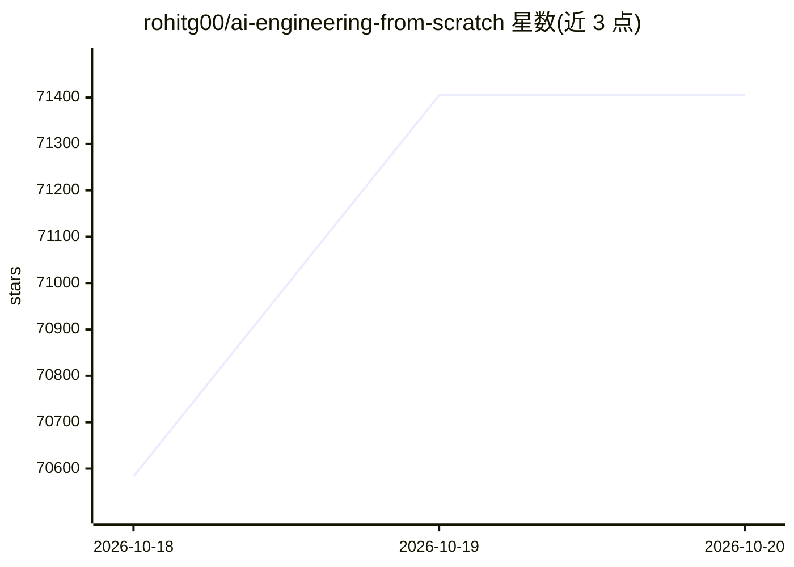

# rohitg00/ai-engineering-from-scratch

⭐ 71,405 · Python · MIT · 推送 2026-10-19 · [GitHub](https://github.com/rohitg00/ai-engineering-from-scratch) · [官网](https://aiengineeringfromscratch.com) · 个人维护 · 中文 README

**AI 工程课程：542 课时的模型、RAG 与 agent 动手教程**

MIT 许可的开源课程仓库，含 542 课时、20 阶段，覆盖数学基础、模型内部实现、检索流水线、agent 运行时、MCP 与 Agent Skills 等，代码含 Python/TypeScript/Rust/Julia。提供三种学习方式：网站直接阅读、通过 npx 安装技能包让 Codex/Claude Code 等编码 agent 充当导师（含摸底测验与个性化计划）、或 git clone 后本地运行课时代码。附三个带参考实现与本地评分器的分阶段项目（检索评测、agent trace 调试、工具调用防火墙）。

## 筛选速览

| 维度 | 判定 | 备注 |
|---|---|---|
| AI 角色 | `ai-knowledge` | 知识聚合/清单类 |
| 许可风险 | `permissive` | MIT |
| 部署形态 | `library` | 以包/库形式分发 |
| 模型依赖 | — | README 未给出锁定关系 |
| 硬件要求 | — | 无带数字的原话,不猜 |
| 安装摩擦 | `low` | 无编译、无系统依赖或容器化 |
| 成熟度 | — | 结构信号不足 |

## 动量与使用信号

- 维护:`active` — 距上次 push 0.6 天,年发版 7,27 位贡献者
- 涨星:近 1 天 **+634**(自 20261016 起算)
- 安装:npm 包 `skills` 月下载 23,786,800
- 平台:— · 协议:MCP

## 能力要点

- 542 课时、20 阶段，覆盖模型内部、检索与 agent 运行时
- npx skills 安装后由编码 agent 担任导师（摸底测验、逐课教学、阶段测验）
- 三个分阶段项目：Python/TypeScript/Rust 各一，附本地评分器
- 多语言 README 与网站学习路径，无需 clone 即可学习

## 适用场景

- 系统学习 AI 工程：从数学基础到 agent 与 MCP
- 用 Claude Code/Codex 等编码 agent 作为交互式导师
- 通过检索评测、trace 调试等实操项目积累作品证据
- 备考 CCAO/CCDV/CCAR 等 Claude 与 MCPA 认证

## 场景标签

`教程课程` · 领域:学习与行业

## 证据(README 行号)

> L9: > 542 lessons. 20 phases. Python, TypeScript, Rust, Julia.
> L12:  542 lessons

## 星数曲线

2026-10-18 70,583 → 2026-10-20 71,405（+822）

---
*卡片 v1 · prompt 1.4 · 生成 2026-10-20 · 置信度 high · 依据 README sha `9c37ca382e4d` · [字段定义](../../DATASET.md)*
