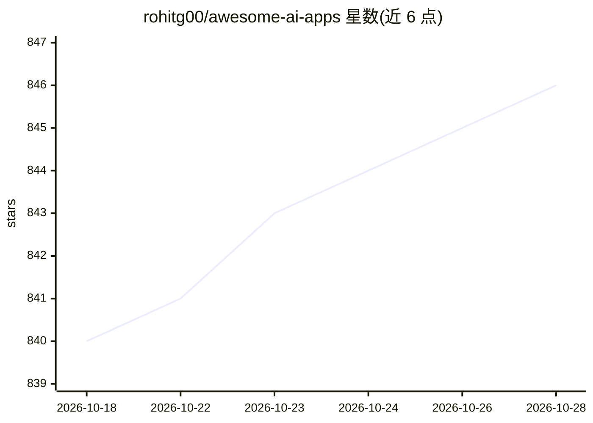

# rohitg00/awesome-ai-apps

⭐ 847 · HTML · Apache-2.0 · 推送 2026-02-10 · [GitHub](https://github.com/rohitg00/awesome-ai-apps) · [官网](https://aiengineeringfromscratch.com) · 个人维护

**实用 AI agent 与 LLM 应用集合（5 类完整示例）**

策展型代码集合：收录按 5 个类别组织的完整 AI 应用——入门 agent、高级 agent、多 agent 团队、RAG 应用与多模态应用，基于 OpenAI、Gemini、Claude、本地 Llama 及 Together AI 等多种模型 API 构建，涵盖对话助手、代码审查、视频 RAG、内容创作团队等场景。项目声明按路线图推进，目标 2025 年底达到 100+ 应用。MIT 许可。面向寻找参考实现的开发者。

## 筛选速览

| 维度 | 判定 | 备注 |
|---|---|---|
| AI 角色 | `ai-knowledge` | 知识聚合/清单类 |
| 许可风险 | `permissive` | Apache-2.0 |
| 部署形态 | `None` |  |
| 模型依赖 | — | README 未给出锁定关系 |
| 硬件要求 | — | 无带数字的原话,不猜 |
| 安装摩擦 | `low` | 无编译、无系统依赖或容器化 |
| 成熟度 | — | 结构信号不足 |

## 能力要点

- 5 类组织：入门/高级/多agent/RAG/多模态
- 覆盖 OpenAI/Gemini/Claude/本地 Llama/Together AI 等模型
- 含视频 RAG、多 agent 内容团队等完整应用示例
- 路线图目标 2025 年底 100+ 应用

## 适用场景

- 学习不同技术栈的 AI agent 实现方式
- 查找 RAG 或多模态应用的参考代码
- 了解多 agent 协作应用的常见模式

## 场景标签

`精选清单` · 领域:学习与行业

## 证据(README 行号)

> L5: A curated collection of **practical AI agents** and generative AI applications built with diverse tech stacks, demon
> L9: This repository contains **complete AI applications** organized into 5 main categories:

## 星数曲线

2026-10-18 840 → 2026-10-28 846（+6）

---
*卡片 v1 · prompt 1.4 · 生成 2026-10-21 · 置信度 high · 依据 README sha `9594ce5d8468` · [字段定义](../../DATASET.md)*
