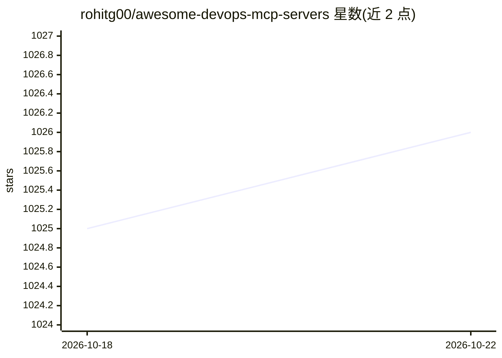

# rohitg00/awesome-devops-mcp-servers

⭐ 1,027 · MIT · 推送 2026-05-12 · [GitHub](https://github.com/rohitg00/awesome-devops-mcp-servers) · [官网](https://createmvps.app/mcp-rules) · 个人维护

**面向 DevOps 工具的 MCP 服务器策展清单**

由个人维护的 awesome 类清单，收录专注于 DevOps 能力的 Model Context Protocol（MCP）服务器实现，覆盖基础设施即代码（Terraform/Pulumi）、容器编排（Kubernetes/Docker/Nomad）、云服务商（AWS/Azure/GCP/阿里云等）、数据库、命令行与版本控制（GitHub/GitLab/Gitea）等类别。每个条目以徽标标注实现语言（Python/TypeScript/Go/Rust 等）、部署范围（云端/本地）与官方实现标识，并链接到相关资源清单。清单本身不含代码，各服务器安装方式见各自仓库。

## 筛选速览

| 维度 | 判定 | 备注 |
|---|---|---|
| AI 角色 | `ai-knowledge` | 知识聚合/清单类 |
| 许可风险 | `permissive` | MIT |
| 部署形态 | `self-host` | docker 或自建部署 |
| 模型依赖 | — | README 未给出锁定关系 |
| 硬件要求 | — | 无带数字的原话,不猜 |
| 安装摩擦 | `low` | 无编译、无系统依赖或容器化 |
| 成熟度 | — | 结构信号不足 |

## 能力要点

- 按 IaC、容器编排、云服务商、数据库、命令行、版本控制等类别组织条目
- 条目标注实现语言、云/本地范围与官方实现（🎖️）标识
- 收录 AWS、Pulumi、GitHub、Gitea、Cloudflare 等官方 MCP 服务器

## 适用场景

- 为 AI 助手挑选管理 Kubernetes 或云资源的 MCP 服务器
- 查找 Terraform、GitHub、命令行等 DevOps 场景的 MCP 接入方案
- 了解 DevOps 领域 MCP 服务器生态的覆盖范围

## 场景标签

`精选清单` · 领域:学习与行业

## 证据(README 行号)

> L3: A curated list of awesome Model Context Protocol (MCP) servers focused on DevOps tools and capabilities.
> L7: MCP is an open protocol that enables AI models to securely interact with local and remote resources through standard
> L34: ## Server Implementations

## 星数曲线

2026-10-18 1,025 → 2026-10-22 1,026（+1）

---
*卡片 v1 · prompt 1.4 · 生成 2026-10-21 · 置信度 mid · 依据 README sha `1dfbca4477cf` · [字段定义](../../DATASET.md)*
