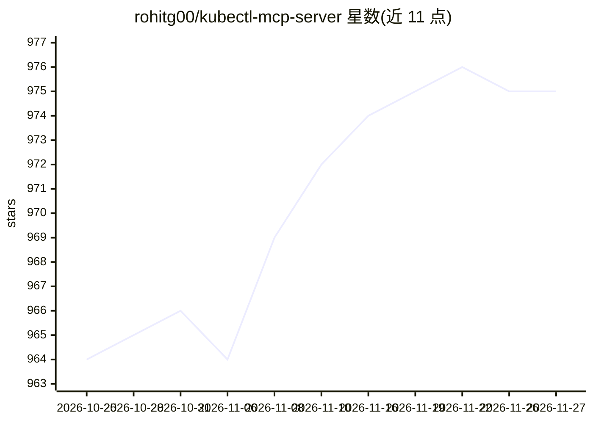

# rohitg00/kubectl-mcp-server

⭐ 975 · Python · MIT · 推送 2026-10-22 · [GitHub](https://github.com/rohitg00/kubectl-mcp-server) · [官网](https://hub.docker.com/mcp/server/kubectl-mcp-server/overview) · 个人维护

**通过自然语言对话管理 Kubernetes 集群的 MCP 服务器**

面向 DevOps/平台工程师的 MCP 服务器，使 AI 助手能通过自然语言操作 Kubernetes 集群：默认注册 core 与 helm 两个工具集共 26 个工具，启用全部工具集可达 209 个，另含 14 个工作流提示与资源模板。覆盖崩溃诊断、部署/扩缩、网络与 DNS 排障、RBAC 与 Secret 安全审计、成本优化、Helm 生命周期、多集群上下文切换等。以 npm/pypi 包与 Docker 镜像分发，提供 OAuth 2.1 鉴权、只读模式与 Secret 脱敏等企业特性。

## 筛选速览

| 维度 | 判定 | 备注 |
|---|---|---|
| AI 角色 | `ai-ecosystem` | LLM/agent 周边工具 |
| 许可风险 | `permissive` | MIT |
| 部署形态 | `self-host` | docker 或自建部署 |
| 模型依赖 | locked-api |  |
| 硬件要求 | — | 无带数字的原话,不猜 |
| 安装摩擦 | `low` | 无编译、无系统依赖或容器化 |
| 成熟度 | — | 结构信号不足 |

## 能力要点

- 默认 26 个工具、全工具集 209 个，按 toolsets 选择性注册以节省上下文
- 覆盖崩溃诊断、安全审计、成本优化、Helm、GitOps、备份等 11 类工具集
- 提供 OAuth 2.1 鉴权、只读模式、Secret 脱敏与 fail-close 网络绑定
- 以 npx/npm/pip/uvx/GitHub Release/Docker 多种方式分发

## 适用场景

- 用自然语言排查 Pod 崩溃与网络连通性问题
- 在 AI 助手中执行安全审计（RBAC、Secret、Pod 安全）
- 通过对话管理 Helm 发布与多集群上下文
- 识别闲置资源并获得成本优化建议

## 场景标签

`AI 助手` · 领域:对话与助手

## 证据(README 行号)

> L5:  Control your entire Kubernetes infrastructure through natural language conversations with AI.
> L73: **26 default tools, 209 with every toolset** | **14 workflow prompts** | **8 resources + 6 resource templates** | *
> L335: Every tool definition costs context on every request, and models pick tools less reliably as the list grows. The s

## 星数曲线

2026-10-25 964 → 2026-11-27 975（+11）

---
*卡片 v1 · prompt 1.4 · 生成 2026-11-24 · 置信度 high · 依据 README sha `2ad87979321f` · [字段定义](../../DATASET.md)*
