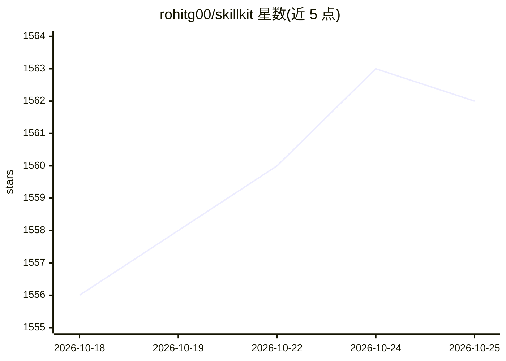

# rohitg00/skillkit

⭐ 1,562 · TypeScript · Apache-2.0 · 推送 2026-06-02 · [GitHub](https://github.com/rohitg00/skillkit) · [官网](https://skillkit.sh) · 个人维护

**AI 编程 agent 技能的包管理器：一次安装，分发到 46 种 agent**

面向 AI 编程 agent 用户的技能包管理 CLI：从 400K+ 技能、31 个来源安装技能，自动在 Claude Code、Cursor、Codex、Copilot 等 46 种 agent 的格式间翻译并部署到对应目录。另提供按项目技术栈的技能推荐、REST/MCP 运行时技能检索服务、会话记忆压缩、技能生成（支持 Claude/GPT-4/Gemini/Ollama/OpenRouter 模型）、团队 .skills manifest 协作与 P2P mesh。npm 全局安装或 npx 零安装使用，Apache 2.0 许可。

## 筛选速览

| 维度 | 判定 | 备注 |
|---|---|---|
| AI 角色 | `ai-ecosystem` | LLM/agent 周边工具 |
| 许可风险 | `permissive` | Apache-2.0 |
| 部署形态 | `library` | 以包/库形式分发 |
| 模型依赖 | local-ok | 支持本地模型 |
| 硬件要求 | — | 无带数字的原话,不猜 |
| 安装摩擦 | `low` | 无编译、无系统依赖或容器化 |
| 成熟度 | — | 结构信号不足 |

## 能力要点

- 跨 46 种 agent 格式的技能安装与自动翻译
- 读取代码库做技术栈感知的技能推荐（recommend）
- REST :3737 与 MCP 两种运行时技能检索服务，含 Python 客户端
- 会话记忆压缩/检索/导出与技能生成（多模型，含本地 Ollama）

## 适用场景

- 把一份技能写一次后同时分发给团队里多种编码 agent
- 根据项目技术栈发现推荐的技能
- 通过 MCP/REST 让 agent 在运行时按需检索技能

## 场景标签

`提示工程` `Agent 记忆` · 领域:Agent 开发

## 证据(README 行号)

> L48: SkillKit is the package manager for AI agent skills. Install from 400K+ skills across 31 sources. Auto-translate be
> L324: |Agent|Format|Directory|

## 星数曲线

2026-10-18 1,556 → 2026-10-25 1,562（+6）

---
*卡片 v1 · prompt 1.4 · 生成 2026-10-21 · 置信度 high · 依据 README sha `d6d2099eff92` · [字段定义](../../DATASET.md)*
