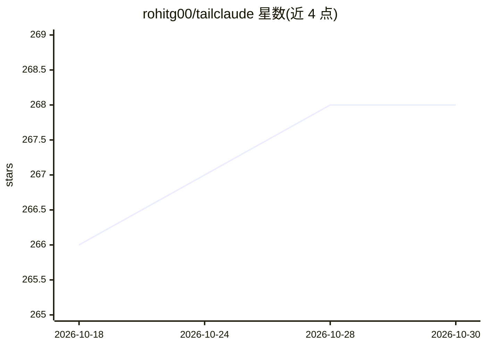

# rohitg00/tailclaude

⭐ 268 · TypeScript · 推送 2026-02-26 · [GitHub](https://github.com/rohitg00/tailclaude) · 个人维护

**浏览器使用 Claude Code 的自托管 Web 网关与界面**

TailClaude 是基于 iii 引擎的 Claude Code Web 前端/代理：在 Tailscale tailnet 或 Funnel 上发布浏览器聊天界面，后端通过 Node.js 代理调用 claude CLI（stream-json 模式）生成流式回复。提供会话索引与历史回放（含终端产生的会话）、模型/权限模式/预算切换、按 Claude API 价格的实时成本与用量看板、系统指标与过载告警、OTel 请求追踪，并通过解析 Claude Code JSONL 文件回填历史成本。给已在终端使用 Claude Code 并想在手机等浏览器设备上访问的开发者。需自备 iii 引擎、Claude Code CLI、Node.js 20+。

## 筛选速览

| 维度 | 判定 | 备注 |
|---|---|---|
| AI 角色 | `ai-ecosystem` | LLM/agent 周边工具 |
| 许可风险 | `none` | — |
| 部署形态 | `library` | 以包/库形式分发 |
| 模型依赖 | locked-api |  |
| 硬件要求 | — | 无带数字的原话,不猜 |
| 安装摩擦 | `low` | 无编译、无系统依赖或容器化 |
| 成熟度 | — | 结构信号不足 |

## 能力要点

- 浏览器 SSE 流式对话并驱动 Claude Code CLI，扫码即可从手机访问
- 按 Claude API 实际价格统计成本与 token，并从 JSONL 会话文件回填历史成本
- 会话索引覆盖终端与 Web 全部会话，支持跨设备断线重连续传
- 系统指标采集、过载告警与 OTel 请求追踪

## 适用场景

- 在手机上通过浏览器使用宿主机上的 Claude Code，无需 SSH
- 在自有 tailnet 内安全访问远程开发机的 Claude Code 会话
- 查看 Claude Code 的成本、用量与请求追踪统计

## 场景标签

`编码 Agent` `LLM 可观测性` · 领域:编码与开发

## 证据(README 行号)

> L50: 4. `POST /chat` spawns `claude -p --output-format stream-json --verbose`, wraps the request in an OTel span (model,
> L61: - Tailscale installed (optional — works locally without it)

## 星数曲线

2026-10-18 266 → 2026-10-30 268（+2）

---
*卡片 v1 · prompt 1.4 · 生成 2026-10-22 · 置信度 high · 依据 README sha `e09290daf645` · [字段定义](../../DATASET.md)*
