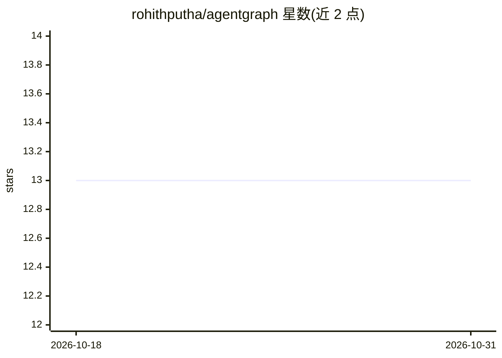

# rohithputha/agentgraph

⭐ 13 · Python · Apache-2.0 · 推送 2026-03-03 · [GitHub](https://github.com/rohithputha/agentgraph) · 个人维护

**LangGraph agent 的 Git 式执行追踪与回归测试工具**

由 agentgit 与 agenttest 两个 Python 包组成，面向 LangGraph agent 开发者：agentgit 通过 LangChain 回调处理器把每次 LLM 调用、工具调用与决策写入 SQLite 执行 DAG，支持查询、分支、checkpoint 恢复与事件订阅，无需修改 agent 代码；agenttest 基于录制的基线做 record-replay 回归测试，提供 pytest 插件、CLI 与 full/locked/selective 三种重放模式（locked 模式全部走缓存、零 API 调用），并定位首个分歧步骤为根因、标记下游级联失败。附带无需 API key 的确定性 mock LLM 示例。

## 筛选速览

| 维度 | 判定 | 备注 |
|---|---|---|
| AI 角色 | `ai-ecosystem` | LLM/agent 周边工具 |
| 许可风险 | `permissive` | Apache-2.0 |
| 部署形态 | `library` | 以包/库形式分发 |
| 模型依赖 | — | README 未给出锁定关系 |
| 硬件要求 | — | 无带数字的原话,不猜 |
| 安装摩擦 | `low` | 无编译、无系统依赖或容器化 |
| 成熟度 | — | 结构信号不足 |

## 能力要点

- 回调一行接入，将 LLM/工具/决策事件写入 SQLite 执行 DAG
- Git 式分支、checkpoint 恢复与事件订阅
- pytest 插件 + CLI 的基线录制与回归检测，定位根因与级联失败
- locked 重放模式 100% 缓存命中、零 API 成本

## 适用场景

- 排查 agent 多次尝试中哪条执行路径接近成功
- 代码变更后自动检测 agent 行为回归
- CI 中零成本重放基线做回归门禁
- 在执行图上分叉探索不同 prompt/工具/模型

## 场景标签

`LLM 可观测性` `模型评测` · 领域:评测与运维

## 证据(README 行号)

> L5: agentgraph gives you **git-like execution tracking** and **record-replay regression testing** for LangGraph agents —
> L16: |**agenttest**|Sits on top of agentgit. Record your agent's correct behaviour once, then automatically flag regress

## 星数曲线

2026-10-18 13 → 2026-10-31 13（+0）

---
*卡片 v1 · prompt 1.4 · 生成 2026-10-31 · 置信度 high · 依据 README sha `81a78bf8166d` · [字段定义](../../DATASET.md)*
